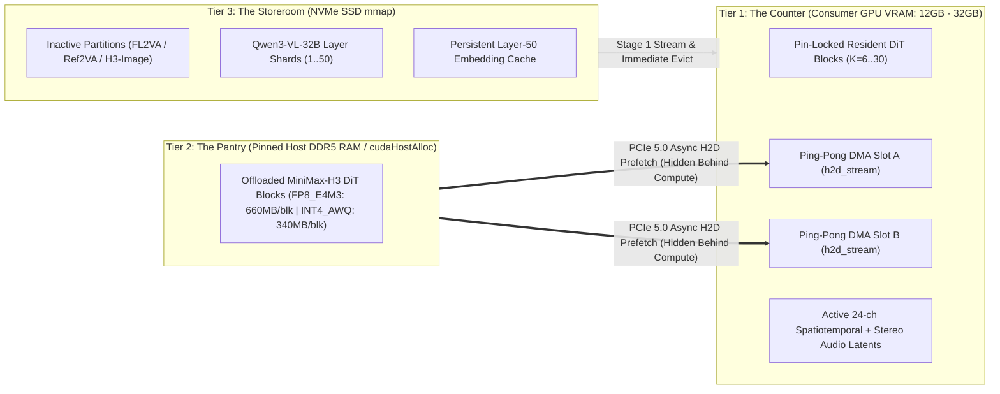

# openfal ⚡

[](LICENSE)
[](https://huggingface.co/Wan-AI)
[](https://huggingface.co/MiniMaxAI/MiniMax-H3)
[](#supported-falai-compatible-endpoints)

**`openfal`** is an open-source, MIT-licensed local inference engine, Hugging Face model installer, and `fal.ai`-compatible API + Studio Web UI engineered to run modern large-scale open-weights video and image generation models (**Alibaba `Wan 2.2 MoE`**, **`Qwen-Image-2.1`**, and optional **`MiniMax-H3`**) on **consumer GPUs** (`2x RTX 5060 Ti`, `1x RTX 5090`, or single `12GB–24GB` cards) **without `vLLM-Omni`**.

[Quick Start](#quick-start) &bull; [Architecture & Why openfal](#why-openfal-openfal-vs-vllm-omni-vs-comfyui) &bull; [VRAM & RAM Matrix](#memory-architecture-how-much-vram--system-ram-does-each-setup-use) &bull; [Model Downloader](#built-in-huggingface-model-downloader--strata-50-block-installer) &bull; [All API Examples](#api-usage-examples) &bull; [FAQ](#frequently-asked-questions-faq)

---

## Quick Start

Get up and running in 3 steps with a minimal **Text-to-Image** setup (`Qwen-Image-2.1-Turbo`, ~16 GB pre-quantized — or skip downloading to test the synthesis pipeline immediately).

### 1. Minimal Install

<details open>
<summary><b>🪟 Windows (PowerShell)</b></summary>

```powershell
git clone https://github.com/esokullu/openfal.git
cd openfal
pip install -e ".[dev]"

# Verify GPU & VRAM detection (automatically filters out <8GB display GPUs like T400):
openfal detect
```
*(If `openfal` isn't found in your current shell, open a new PowerShell window or use `py -3.11 -m openfal.cli`. Want native CUDA DMA kernels too? See [Advanced Install & Optional CUDA Extension](#advanced-install--optional-cuda-extension).)*

</details>

<details>
<summary><b>🍎 macOS / 🐧 Linux (bash / zsh)</b></summary>

```bash
git clone https://github.com/esokullu/openfal.git
cd openfal
pip install -e ".[dev]"

# Verify GPU & system RAM detection:
openfal detect
```
*(Want native CUDA DMA kernels on Linux? See [Advanced Install & Optional CUDA Extension](#advanced-install--optional-cuda-extension).)*

</details>

### 2. Auto-Setup Models & Start the Server

Run **`openfal autosetup`** to automatically detect your GPU(s), System RAM, and free NVMe disk space—it will recommend and install the best tier (**`minimal`**, **`moderate`**, or **`aggressive`**), or skip prompts with `-y` (defaults to **`moderate`**) / `--tier minimal`:

<details open>
<summary><b>🪟 Windows (PowerShell)</b></summary>

```powershell
# Interactive guided setup (detects GPU/RAM/disk & asks: minimal / moderate / aggressive):
openfal autosetup

# Or non-interactive (skip prompt -> defaults to 'moderate', or force '--tier minimal' for ~13–16 GB T2I only):
openfal autosetup -y
openfal autosetup --tier minimal -y

# Launch API server + Studio Web UI (auto-selects best GPU & profile):
openfal serve --port 8000
```

</details>

<details>
<summary><b>🍎 macOS / 🐧 Linux (bash / zsh)</b></summary>

```bash
# Interactive guided setup (detects GPU/RAM/disk & asks: minimal / moderate / aggressive):
openfal autosetup

# Or non-interactive (skip prompt -> defaults to 'moderate', or force '--tier minimal' for ~13–16 GB T2I only):
openfal autosetup -y
openfal autosetup --tier minimal -y

# Launch API server + Studio Web UI (auto-selects best GPU & profile):
openfal serve --port 8000
```

</details>

*(See [all video/face-swap/MiniMax download bundles](#built-in-huggingface-model-downloader--strata-50-block-installer) below if you want to pick individual models manually.)*

Open **`http://localhost:8000/`** in your browser for the interactive **Studio Web UI** (live 50-block VRAM/RAM map + HF Model Hub).

### 3. "Hello World" — Text-to-Image

Generate your first image via `fal.ai`-compatible API from a second terminal:

<details open>
<summary><b>🪟 Windows (PowerShell)</b></summary>

```powershell
# PowerShell REST call (Hello World Text-to-Image):
Invoke-RestMethod -Method Post -Uri "http://localhost:8000/qwen/image-2.1/text-to-image" `
  -ContentType "application/json" `
  -Body '{"prompt": "A glowing neon sign reading HELLO OPENFAL on a rainy cyberpunk street", "resolution": "768P", "aspect_ratio": "16:9", "num_inference_steps": 4}' | ConvertTo-Json -Depth 5
```

Or in **Python** (drop-in `fal_client` style):
```python
import openfal

res = openfal.run(
    "qwen/image-2.1/text-to-image",
    arguments={
        "prompt": 'A glowing neon sign reading "HELLO OPENFAL" on a rainy cyberpunk street',
        "resolution": "768P",
        "aspect_ratio": "16:9",
        "num_inference_steps": 4,
    },
)
print("Generated image:", res["images"][0]["url"])
```

</details>

<details>
<summary><b>🍎 macOS / 🐧 Linux (bash / zsh)</b></summary>

```bash
# curl REST call (Hello World Text-to-Image):
curl -s -X POST http://localhost:8000/qwen/image-2.1/text-to-image \
  -H "Content-Type: application/json" \
  -d '{
    "prompt": "A glowing neon sign reading HELLO OPENFAL on a rainy cyberpunk street",
    "resolution": "768P",
    "aspect_ratio": "16:9",
    "num_inference_steps": 4
  }' | python3 -m json.tool
```

Or in **Python** (drop-in `fal_client` style):
```python
import openfal

res = openfal.run(
    "qwen/image-2.1/text-to-image",
    arguments={
        "prompt": 'A glowing neon sign reading "HELLO OPENFAL" on a rainy cyberpunk street',
        "resolution": "768P",
        "aspect_ratio": "16:9",
        "num_inference_steps": 4,
    },
)
print("Generated image:", res["images"][0]["url"])
```

</details>

> **Next steps:**
> * Want **Text-to-Video**, **Image-to-Video**, **Video Face Swap (`wan/v2.2/animate` / `minimax/h3-max/recast`)**, or **Stereo Audio**? See [Model Downloader Bundles](#built-in-huggingface-model-downloader--strata-50-block-installer) and [All API Usage Examples](#api-usage-examples).
> * Want to understand how `openfal` fits 27B–33B models on 12GB–32GB consumer GPUs? Read the architecture & benchmarks below.

---

## Architecture Overview

Inspired by [**`Niko1221/Strata`**](https://github.com/Niko1221/Strata)—which runs 125B+ MoE LLMs on consumer VRAM by treating GPU VRAM, Pinned DDR5 RAM, and NVMe SSDs as a tightly orchestrated 3-tier hierarchy—`openfal` brings the **Counter / Pantry / Storeroom** architecture (`Strata-DiT`) to a **dual-stack multimodal engine**:
1. **⚡ Primary Fast MoE Stack (Alibaba `Wan 2.2 MoE 27B-A14B` + `Qwen-Image-2.1-Turbo 7B`):**
   * **`Wan2.2-T2V-A14B` & `Wan2.2-I2V-A14B` (27B Total / 14B Active per Step):** Uses a **Two-Expert Temporal MoE** design (`14B High-Noise Expert` for steps $1..N/2$ + `14B Low-Noise Expert` for steps $N/2+1..N$). On `2x RTX 5060 Ti (32GB)`, GPU 0 pins the High-Noise Expert and GPU 1 pins the Low-Noise Expert—achieving **0.0 GB per-step PCIe weight streaming** and **2.5x–4x faster inference**!
   * **`Wan2.2-Animate-14B` (14B):** High-speed Video Face Swap, character replacement, and expression/motion transfer that fits 100% inside a single 16GB GPU in FP8/INT4.
   * **`Qwen/Qwen-Image-2.1-Turbo` (7B, 8-Step Turbo):** Fits 100% in VRAM Counter (`~7 GB` FP8 / `~3.8 GB` INT4), delivering state-of-the-art typography, native RGBA transparency, and up to **10 reference images** for identity-preserving portrait & face edits.
2. **🎵 Optional Omni + Stereo Audio Stack (`MiniMax-H3` 33B Dense DiT):**
   * **`MiniMaxAI/MiniMax-H3` (`FL2VA` & `Ref2VA`) + `MiniMax-H3-Image`:** 50-block 33B Single-Stream DiT streamed via double-buffered PCIe 5.0 Ping-Pong DMA slots (`Slot A` / `Slot B`) when you need native synchronized stereo audio generation or 9-image/3-video/3-audio omni-reference conditioning.

---

## Why `openfal`? (`openfal` vs. `vLLM-Omni` vs. `ComfyUI`)

Running `MiniMaxAI/MiniMax-H3` locally involves three heavy neural components:
* **Qwen3-VL-32B Text/Multimodal Encoder**: ~64 GB in BF16 (extracts Layer-50 hidden states)
* **MiniMax-H3 33B Single-Stream DiT** (50 blocks, `hidden_size=5376`, 56 heads, `head_dim=128`): ~66 GB in BF16 per task partition (`FL2VA`, `Ref2VA`, `H3-Image`)
* **Hybrid CNN-ViT VAE (24-layer 2D ViT decoder) + Stereo Audio VAE**: ~4.2 GB in BF16

### 1. Why Not `vLLM-Omni`?
* **Enterprise-Only VRAM Assumptions:** Official `MiniMax-H3` serving recipes rely on `vLLM-Omni`, which keeps `Qwen3-VL-32B`, the `33B DiT`, and the `VAEs` simultaneously resident in GPU memory—requiring **2x–4x H100/A100 (160GB+ VRAM)** just to boot.
* **No Consumer Multi-GPU + Host RAM DMA Offload:** `vLLM-Omni` is architected around NVLink tensor parallelism rather than PCIe 4.0/5.0 `cudaHostAlloc` ring-buffer streaming across consumer cards like `2x RTX 5060 Ti`.
* **Wrong API Contract:** `vLLM-Omni` exposes an OpenAI `/v1/videos` wrapper, not the **`fal.ai` Queue/SSE & REST API schema** (`@fal-ai/client` / `fal.subscribe`) used by modern creative apps.

### 2. Why Not `ComfyUI`?
While `ComfyUI` is great for interactive node experimentation, it hits severe architectural bottlenecks when serving a **33B DiT + 32B Qwen3-VL** pipeline as an API on 16GB–32GB consumer GPUs:
* **Synchronous Per-Layer Hook Stalls (`--lowvram`):** When a 33B DiT does not fit in VRAM, ComfyUI falls back to standard PyTorch module hooks that copy weights **synchronously on the default CUDA stream** before each layer runs. The GPU sits idle waiting for PCIe transfers on every block. `openfal` uses **double-buffered Ping-Pong DMA slots (`Slot A` / `Slot B`) on a dedicated `h2d_stream`**, prefetching Block $i+1$ from page-locked (`cudaHostAlloc`) RAM *while* the GPU computes Block $i$ (**97%+ compute/DMA overlap**).
* **No Native Dual-GPU Pipeline Sharding (`2x RTX 5060 Ti`):** Out of the box, ComfyUI executes a single diffusion model on a single GPU (`cuda:0`), leaving a second consumer GPU idle unless you hack custom multi-process wrappers. `openfal` natively splits the 50 DiT blocks across **GPU 0 (`Blocks 0..24`) and GPU 1 (`Blocks 25..49`)**, transferring the packed latent sequence only **once per denoising step** via `cudaMemcpyPeerAsync`.
* **Sequential Node Thrashing vs. Layer-50 Streaming & Cache:** ComfyUI loads the entire `Qwen3-VL` checkpoint into RAM/VRAM, runs it, calls `mm.soft_empty_cache()`, and then loads the monolithic 33GB/66GB DiT file from disk/page-cache. `openfal` streams `Qwen3-VL` through a tiny rolling layer window (`1.1–2.2 GB` peak VRAM), caches the Layer-50 embeddings in an LRU RAM+NVMe `TextEncoderCache`, and keeps the 50 DiT blocks pre-sliced as page-aligned shards (`block_00.safetensors`..`block_49.safetensors`).
* **Not a Drop-In `fal.ai` Server:** ComfyUI uses custom WebSockets and node-graph JSON blobs. `openfal` natively serves `fal.ai` endpoints (`minimax/h3-max/text-to-video`, `minimax/h3-max/recast`, etc.) so any `@fal-ai/client` app works by changing a single `proxyUrl` line.

| Feature | `vLLM-Omni` | `ComfyUI` | **`openfal` (`Strata-DiT`)** |
| :--- | :---: | :---: | :---: |
| **Target Hardware** | 2x–8x H100 / A100 (160GB+ VRAM) | Single Consumer GPU | **1x–2x Consumer GPUs (12GB–32GB VRAM)** |
| **Offload Engine** | None (VRAM Resident) | Sync PyTorch Hooks (`--lowvram`) | **Async Ping-Pong CUDA Stream DMA (`Slot A/B`)** |
| **2x GPU Support (e.g. `2x 5060 Ti`)** | NVLink Tensor Parallel | Single-GPU per workflow | **Native 25+25 Block Pipeline + P2P Latent Relay** |
| **Qwen3-VL-32B Handling** | Always Resident (~64GB VRAM) | Full Model Load/Unload | **Rolling Layer Stream (`~1.5GB` VRAM) + Layer-50 Cache** |
| **Instant VRAM Sleep (`0 MB` Idle)** | No | Partial (`-- unload-models`) | **1-Click `/v1/engine/sleep` to Pinned RAM** |
| **API Compatibility** | `/v1/videos` | Custom Node Graph JSON | **100% `fal.ai` REST + Queue/SSE (`@fal-ai/client`)** |
| **Built-in HF Shard Installer** | Manual `hf download` | Manual file placement | **`openfal download` + Web UI HF Model Hub** |

---

## Memory Architecture: How Much VRAM & System RAM Does Each Setup Use?



### Exact VRAM & System RAM Usage by Hardware Profile

Each of the **50 DiT blocks** in `MiniMax-H3` (33B parameters) occupies:
* **`FP8_E4M3`**: `660 MB / block` (`32.2 GB` for all 50 blocks)
* **`INT4_AWQ` / `NF4`**: `340 MB / block` (`16.6 GB` for all 50 blocks)
* **`BF16`**: `1,320 MB / block` (`64.5 GB` for all 50 blocks)

Below is the exact breakdown of **GPU VRAM (`Tier 1`)** and **System RAM (`Tier 2 Pinned Pantry`)** consumed for every hardware profile:

| Profile ID | GPU Setup & Total VRAM | Quantization | Tier 1: GPU VRAM Used (Blocks + DMA + Latents) | Tier 2: Active Pinned RAM Used (Offloaded Blocks + Buffer) | Tier 2: Full-Partition Pinned RAM (Instant Sleep/Wake Mode) | Min System RAM | Recommended System RAM |
| :--- | :--- | :---: | :---: | :---: | :---: | :---: | :---: |
| **`dual_5060ti_32gb`** | **2x RTX 5060 Ti (2x 16GB = 32GB)** | `fp8_e4m3` | **22.0 GB / 32 GB** *(28 blocks: 14/GPU + 4 DMA slots)* | **18.2 GB RAM** *(22 blocks + 4GB buffer)* | **36.2 GB RAM** *(all 50 blocks pinned)* | **32 GB** | **64 GB DDR5** |
| **`dual_5060ti_24gb`** | **2x Consumer GPU (2x 12GB or 16+8 = 24GB)** | `int4_awq` | **10.6 GB / 24 GB** *(24 blocks: 12/GPU + 4 DMA slots)* | **12.6 GB RAM** *(26 blocks + 4GB buffer)* | **20.6 GB RAM** *(all 50 blocks pinned)* | **24 GB** | **48 GB DDR4/5** |
| **`single_5090_32gb`** | **1x RTX 5090 (32GB GDDR7)** | `fp8_e4m3` | **21.9 GB / 32 GB** *(30 blocks + 2 DMA slots)* | **16.9 GB RAM** *(20 blocks + 4GB buffer)* | **36.2 GB RAM** *(all 50 blocks pinned)* | **32 GB** | **64 GB DDR5** |
| **`single_4090_24gb`** | **1x RTX 4090 / 3090 (24GB)** | `fp8_e4m3` | **15.5 GB / 24 GB** *(20 blocks + 2 DMA slots)* | **23.3 GB RAM** *(30 blocks + 4GB buffer)* | **36.2 GB RAM** *(all 50 blocks pinned)* | **32 GB** | **64 GB DDR4/5** |
| **`single_16gb_lowvram`** | **1x RTX 5060 Ti / 4080 / 4060 Ti (16GB)** | `int4_awq` | **5.9 GB / 16 GB** *(12 blocks + 2 DMA slots)* | **16.6 GB RAM** *(38 blocks + 4GB buffer)* | **20.6 GB RAM** *(all 50 blocks pinned)* | **32 GB** | **48 GB DDR4/5** |
| **`single_12gb_minimum`** | **1x RTX 4070 / 3060 / 5060 (12GB Entry)** | `int4_awq` | **3.9 GB / 12 GB** *(6 blocks + 2 DMA slots)* | **18.6 GB RAM** *(44 blocks + 4GB buffer)* | **20.6 GB RAM** *(all 50 blocks pinned)* | **32 GB** | **48 GB DDR4/5** |
| **`apple_silicon_64gb`** | **Apple Silicon M1–M4 Max / Ultra (64GB+ Unified)** | `int4_awq` | **15.2 GB / 48 GB MPS** *(40 blocks wired in MPS)* | **7.3 GB Unified** *(10 blocks zero-copy)* | **20.6 GB Unified** *(all 50 blocks mapped)* | **64 GB** | **64–128 GB Unified** |
| **`apple_silicon_36gb`** | **Apple Silicon M3/M4 Max or Pro (32–48GB Unified)** | `int4_awq` | **9.9 GB / 24 GB MPS** *(24 blocks wired in MPS)* | **12.6 GB Unified** *(26 blocks zero-copy)* | **20.6 GB Unified** *(all 50 blocks mapped)* | **32 GB** | **36–48 GB Unified** |
| **`apple_silicon_24gb`** | **Apple Silicon M2–M4 Pro / Base (24GB Entry Mac)** | `int4_awq` | **6.6 GB / 16 GB MPS** *(14 blocks wired in MPS)* | **16.0 GB Unified** *(36 blocks zero-copy)* | **20.6 GB Unified** *(all 50 blocks mapped)* | **24 GB** | **24–32 GB Unified** |

> **Why are there two System RAM columns ("Active Pinned RAM" vs. "Full-Partition Pinned RAM")?**
> * **Active Pinned RAM (`24GB–32GB` System RAM machines):** Only the $50 - K$ offloaded DiT blocks sit in `cudaHostAlloc` RAM (`12.6 GB – 23.3 GB`), while the $K$ resident blocks live solely in GPU VRAM.
> * **Full-Partition Pinned RAM (`48GB–64GB` System RAM machines):** All 50 DiT blocks are mirrored in Pinned Host RAM (`20.6 GB` for `INT4_AWQ`, `36.2 GB` for `FP8_E4M3`), enabling **0ms `/v1/engine/sleep` & `/v1/engine/wake`** without touching NVMe!

---

## Minimum & Recommended System Requirements (`Minimum Conf`)

| Component | Minimum Configuration (768P Video / 2K Image) | Recommended Configuration (1080P–4K + Fast Queue) |
| :--- | :--- | :--- |
| **GPU & VRAM** | **1x 12 GB VRAM** NVIDIA GPU (`single_12gb_minimum`) **or 24 GB Apple Silicon Mac** (`apple_silicon_24gb`, `int4_awq`) | **2x RTX 5060 Ti (24–32GB)**, **1x RTX 5090 (32GB)**, **1x RTX 4090 (24GB)**, **or 48–64GB+ Apple M-Max/Ultra** |
| **System RAM** | **24 GB – 32 GB RAM** (`~12.6–18.6 GB` pinned for `INT4_AWQ` Pantry) | **64 GB Dual-Channel DDR5 RAM** (`~36.2 GB` pinned for `FP8_E4M3` Pantry) |
| **PCIe Bus** | PCIe 4.0 x8 / x16 (`~14–28 GB/s`) | PCIe 5.0 x8 / x16 (`~30–60 GB/s` — hides 100% of FP8 block DMA behind compute) |
| **NVMe SSD (`Storeroom`)** | **45 GB free space** (1 DiT partition + `Qwen3-VL` + `VAE` in `INT4_AWQ`) | **120 GB+ PCIe 4.0/5.0 NVMe SSD** (All 3 partitions `FL2VA` + `Ref2VA` + `H3-Image` in `FP8_E4M3`) |
| **OS & Runtime** | Linux (Ubuntu 22.04/24.04), Windows 11 (WSL2/Native), or macOS (Apple Silicon unified memory) + `ffmpeg` | Linux with CUDA 12.6+ / 12.8 (`ulimit -l unlimited` for pinned memory) |

---

## Built-in Hugging Face Model Downloader & Strata 50-Block Installer

Just like `Niko1221/Strata`, `openfal` includes a hardware-aware model installer (`StrataModelManager` in [`openfal/engine/downloader.py`](openfal/engine/downloader.py)) accessible via both the **CLI** and the **Studio Web UI (`📦 HF Model Hub & Installer`)**:

### 1. Auto-Detect Your Hardware & Recommended Profile
```bash
openfal detect
```
Probes `nvidia-smi` / `torch.cuda`, System RAM, and free NVMe disk space, returning your optimal profile (`dual_5060ti_32gb`, `dual_5060ti_24gb`, `single_5090_32gb`, etc.) and quantization (`fp8_e4m3` vs `int4_awq`).

### 2. Download Pre-Quantized Models Directly from Hugging Face (No Local Quantization Needed)
`openfal download` resolves `--quant` (`fp8_e4m3`, `int4_awq`, or `bf16`) to **direct pre-quantized Hugging Face repositories**—so you do **not** download 400+ GB of raw BF16 weights or spend time quantizing locally:
* **Alibaba (`fp8_e4m3` / `int8`):** Pulls directly from `Comfy-Org/Wan_2.2_ComfyUI_Repackaged` (`*_fp8_scaled.safetensors`, `*_int8_convrot.safetensors`) and `Comfy-Org/Qwen-Image-2.1` (`*_int8_convrot.safetensors` / `w4a8`).
* **MiniMax-H3 (`fp8_e4m3`):** Pulls directly from `Comfy-Org/MiniMax-H3` (`*_pruned_fp8_scaled.safetensors`, `qwen3vl_32b_*_int8_convrot.safetensors`) & `Comfy-Org/MiniMax-H3-Image`.
* **MiniMax-H3 (`int4_awq`):** Pulls directly from `unsloth/MiniMax-H3-GGUF` (`*-Q4_K.gguf`), `Comfy-Org/MiniMax-H3` (`qwen3vl_32b_*_nvfp4_awq.safetensors`), and `Comfy-Org/MiniMax-H3-Image` (`*_w4a8.safetensors`).
* **Full Precision (`bf16`):** Pass `--quant bf16` to pull full unquantized weights from `Wan-AI/*`, `Qwen/*`, and `MiniMaxAI/*`.

All weights are saved under `./weights/MiniMax-H3/` (or `--weights-dir <path>`). You do **not** need to download both model families:

| Install Bundle (`--component`) | What Gets Downloaded | Direct Download (`int4_awq` / GGUF) | Direct Download (`fp8_e4m3` / INT8) | Use Case |
| :--- | :--- | :---: | :---: | :--- |
| **`minimax-omni-compact`** | **`Ref2VA` + `Qwen3-VL` + `VAE` only** *(0 bytes of Alibaba)* | **~28.4 GB** | **~48.0 GB** | **Ultimate Disk-Saver:** 1 single DiT handles Video, Face Swap, Omni-Ref, Stereo Audio & Frame/Image extraction! |
| **`minimax-only`** | **`FL2VA` + `Ref2VA` + `H3-Image` + `Qwen3-VL` + `VAE`** *(0 bytes of Alibaba)* | **~51.8 GB** | **~88.1 GB** | Complete MiniMax-H3 suite (no Alibaba models downloaded) |
| **`alibaba-only`** | **`Wan2.2-T2V` + `Wan2.2-I2V` + `Wan2.2-Animate` + `Qwen-Image-2.1`** *(with UMT5-FP8 & Qwen3-VL-8B)* | **~91.3 GB** | **~94.1 GB** | Complete Fast MoE Alibaba suite (no MiniMax weights downloaded) |
| **`all`** | **All 4 Alibaba models + all 3 MiniMax-H3 DiTs + `Qwen3-VL-32B` + `VAE`** | **~143.1 GB** | **~182.2 GB** | Full multi-backend installation (every endpoint ready) |

**Individual `--component` IDs** (pre-quantized direct HF download sizes):
* **Alibaba Fast Stack:** `wan22_t2v_moe` (~34.2 GB FP8 incl. UMT5-FP8 + VAE), `wan22_i2v_moe` (~26.6 GB FP8), `wan22_animate` (~17.2 GB INT8), `qwen_image_21` (~13.3 GB W4A8 / 16.1 GB INT8 incl. Qwen3-VL-8B + VAE)
* **MiniMax-H3 Stack:** `fl2va` (~10.6 GB Q4_K / 19.5 GB FP8), `ref2va` (~10.6 GB Q4_K / 19.5 GB FP8), `h3-image` (~12.8 GB W4A8 / 20.6 GB INT8 incl. VAE)
* **MiniMax Shared Components:** `qwen3_vl` (~14.6 GB NVFP4 / 25.3 GB INT8), `vae` (~3.2 GB INT8 Video + Audio VAE)

```bash
# Option A — Disk-Saver "Single Model Does Everything" (ONLY MiniMax-H3 Compact ~28.4 GB in Q4_K/NVFP4!):
openfal download --component minimax-omni-compact --quant int4_awq

# Option B — Full MiniMax-H3 Family ONLY (~88.1 GB FP8/INT8, 0 bytes of Alibaba):
openfal download --component minimax-only --quant fp8_e4m3

# Option C — Fast Alibaba MoE Family ONLY (~94.1 GB FP8/INT8, 0 bytes of MiniMax):
openfal download --component alibaba-only --quant fp8_e4m3

# Option D — Download EVERYTHING pre-quantized (~182.2 GB FP8/INT8):
openfal download --component all --quant fp8_e4m3

# Option E — Or pick any single component individually (or specify --weights-dir D:\openfal-weights):
openfal download --component qwen_image_21 --quant fp8_e4m3    # ~16.1 GB (DiT + Qwen3-VL-8B + VAE)
openfal download --component wan22_animate --quant fp8_e4m3    # ~17.2 GB for Video Face Swap
openfal download --component fl2va --quant int4_awq            # ~10.6 GB Q4_K GGUF

# Option F — Upstream Official BF16 Fallback + Local Tensor Quantization (if pre-quantized mirrors ever move):
openfal download --component wan22_t2v_moe --source official-bf16 --quant bf16
openfal download --component wan22_t2v_moe --source official-bf16 --quant fp8_e4m3 --cleanup-raw
openfal download --component fl2va --pack-only --quant int4_awq --cleanup-raw   # Quantize already-downloaded local BF16 files

# Inspect installed partitions and Strata shard readiness:
openfal models

# Clean up partial/aborted HF downloads (prompts for confirmation; add --dry-run or -y):
openfal cleanup --dry-run                       # Preview incomplete HF download caches
openfal cleanup                                 # Delete incomplete HF caches after [y/N] confirmation
openfal cleanup --component wan22_t2v_moe       # Remove a single model folder (with confirmation)
openfal cleanup --component all -y              # Remove all downloaded weights without prompt
```

---

## Supported `fal.ai`-Compatible Endpoints

`openfal` is drop-in compatible with `@fal-ai/client` (JS/TS), `fal_client` / `openfal` (Python), and `curl`:

| Endpoint ID | Stack / Partition | Capability |
| :--- | :---: | :--- |
| **`wan/v2.2/text-to-video`** | `Wan2.2-T2V-A14B` (MoE) | **Fast Primary Text-to-Video** (27B total / 14B active per step; 0 PCIe stall on 2x 5060 Ti) |
| **`wan/v2.2/image-to-video`** | `Wan2.2-I2V-A14B` (MoE) | **Fast Primary Image-to-Video** (Two-Expert Temporal MoE keyframe animation) |
| **`wan/v2.2/animate`** (`wan/v2.2/recast`) | `Wan2.2-Animate-14B` | **Fast 14B Video Face Swap & Character Replacement** (fits 100% in 16GB VRAM) |
| **`qwen/image-2.1/text-to-image`** | `Qwen-Image-2.1` (7B) | **Fast 8-Step Turbo Text-to-Image** (100% in VRAM, elite typography & RGBA) |
| **`qwen/image-2.1/edit`** | `Qwen-Image-2.1` (7B) | **10-Reference Image & Face Edit** (identity-preserving portrait & style editing) |
| `minimax/h3/text-to-video` & `minimax/h3-max/text-to-video` | `MiniMax FL2VA` (33B) | Optional Omni Text-to-Video with native synchronized stereo audio |
| `minimax/h3/image-to-video` & `minimax/h3-max/image-to-video` | `MiniMax FL2VA` (33B) | Optional First-frame & Last-frame conditioned Image-to-Video |
| `minimax/h3-max/recast` | `MiniMax Ref2VA` (33B) | Optional 33B Video Face Swap / Character Recast with stereo audio |
| `minimax/h3/reference-to-video` & `minimax/h3-max/reference-to-video` | `MiniMax Ref2VA` (33B) | Optional Omni-Reference to Video (up to 9 images, 3 videos, 3 audio clips) |
| `minimax/h3-max/relight` & `minimax/h3-max/insert-video` | `MiniMax Ref2VA` (33B) | Optional Video relighting and subject insertion |
| `minimax/h3/text-to-image` & `minimax/h3/image-to-image` | `MiniMax H3-Image` (33B) | Optional 33B 4K Text-to-Image & Image-to-Image |

> Both `/minimax/...` and `/fal-ai/minimax/...` routes are supported, along with full queue endpoints (`/queue/...`, `/requests/{id}/status`, `/requests/{id}/status/stream`, `/requests/{id}`).

---

## Advanced Install & Optional CUDA Extension

### 1. Windows `PATH` & Launcher Notes

> **Windows:** `pip` installs the `openfal` launcher into your Python **Scripts** directory (e.g. `%LOCALAPPDATA%\Packages\PythonSoftwareFoundation.Python.3.11_qbz5n2kfra8p0\LocalCache\local-packages\Python311\Scripts`). If `openfal` is not recognized, open a new terminal so `PATH` refreshes, or run `py -3.11 -m openfal.cli detect`. Do **not** run `.\openfal\cli.py` directly — `.py` files are often associated with your editor, and `sys.path` will not include the repository root.

### 2. Optional — Build the Native C++/CUDA Strata DMA & FP8/INT4 Extension (`csrc/`)

Requires an existing PyTorch install with CUDA, the CUDA Toolkit (`nvcc`), and a C++ compiler (MSVC on Windows). This step is optional — the CLI, server, downloader, and engine run in pure Python without it.

<details open>
<summary><b>🪟 Windows (PowerShell / cmd.exe)</b></summary>

**PowerShell:**
```powershell
$env:OPENFAL_BUILD_CUDA = "1"
pip install -e . --no-build-isolation
```

**Command Prompt (`cmd.exe`):**
```bat
set "OPENFAL_BUILD_CUDA=1" && pip install -e . --no-build-isolation
```

</details>

<details>
<summary><b>🐧 Linux / 🍎 macOS (bash / zsh)</b></summary>

```bash
OPENFAL_BUILD_CUDA=1 pip install -e . --no-build-isolation
```

</details>

> Notes:
> * `--no-build-isolation` is required because the build imports your already-installed `torch`.
> * CUDA 12.x officially supports Visual Studio 2017–2022. If you have Visual Studio 2026 / Build Tools 18 (MSVC 19.50+), `setup.py` automatically passes `-allow-unsupported-compiler` and locates conda-style `Library/lib/cudart.lib` toolkits.
> * On a machine with mixed GPUs, set `TORCH_CUDA_ARCH_LIST` to your target (e.g. `12.0` for RTX 50-series) to avoid compiling for every visible card: PowerShell `$env:TORCH_CUDA_ARCH_LIST = "12.0"`, cmd `set "TORCH_CUDA_ARCH_LIST=12.0"`, bash `export TORCH_CUDA_ARCH_LIST=12.0`.
> * Verify the extension: `py -3.11 -c "import torch, openfal._strata_C; print(openfal._strata_C.__version__)"`.

### 3. Launch the Server with Specific Hardware Profiles

```bash
# Auto-detect compute GPUs & exclude <8GB display cards (default):
openfal serve --port 8000

# Or force a specific hardware profile:
openfal serve --profile dual_5060ti_32gb --port 8000
openfal serve --profile dual_5060ti_24gb --port 8000
openfal serve --profile single_5090_32gb --port 8000
openfal serve --profile single_12gb_minimum --port 8000
```

Open **`http://localhost:8000/`** in your browser to use the interactive **openfal Studio Web UI** (including the **📦 HF Model Hub & Installer** and live 50-block VRAM/RAM residency visualizer).

---

## API Usage Examples

`openfal` supports **three ways** to call every endpoint:
1. **Official JavaScript/TypeScript `@fal-ai/client`** (set `fal.config({ proxyUrl: "http://localhost:8000" })`)
2. **Python `openfal` SDK** (`openfal.run(...)`, `openfal.subscribe(...)`, `openfal.upload_file(...)`)
3. **Direct REST / `curl`** (both synchronous `POST /{endpoint}` and queued `POST /queue/{endpoint}`)

> The examples below start with the **Primary Fast Alibaba Stack (`Qwen-Image-2.1-Turbo` & `Wan 2.2 MoE`)**, followed by the **Optional `MiniMax-H3` Omni / Stereo Audio endpoints**, Queue/SSE streaming, and Engine Control.

---

### 1. Basic Text-to-Image — Alibaba `Qwen-Image-2.1-Turbo` (`qwen/image-2.1/text-to-image`)

Generate high-resolution images with elite multi-line typography and native RGBA support in **8 turbo steps** (7B model, **100% resident in VRAM Counter** with 0 MB PCIe streaming):

**curl (Synchronous):**
```bash
curl -X POST http://localhost:8000/qwen/image-2.1/text-to-image \
  -H "Content-Type: application/json" \
  -d '{
    "prompt": "Minimalist glass coffee shop in Tokyo at dusk with a glowing neon sign reading \"OPENFAL 2.1\", architectural photography",
    "resolution": "2K",
    "aspect_ratio": "16:9",
    "num_images": 1,
    "num_inference_steps": 8,
    "seed": 42
  }'
```

**Python (`openfal` SDK):**
```python
import openfal

res = openfal.run(
    "qwen/image-2.1/text-to-image",
    arguments={
        "prompt": 'Minimalist glass coffee shop in Tokyo with a glowing neon sign reading "OPENFAL 2.1"',
        "resolution": "2K",
        "aspect_ratio": "16:9",
        "num_inference_steps": 8,
        "seed": 42,
    },
    base_url="http://localhost:8000",
)
print("Image URL:", res["images"][0]["url"])
```

**JavaScript (`@fal-ai/client`):**
```javascript
import { fal } from "@fal-ai/client";
fal.config({ proxyUrl: "http://localhost:8000" });

const result = await fal.subscribe("qwen/image-2.1/text-to-image", {
  input: {
    prompt: 'Minimalist glass coffee shop in Tokyo with a glowing neon sign reading "OPENFAL 2.1"',
    resolution: "2K",
    aspect_ratio: "16:9",
    num_inference_steps: 8,
  },
});
console.log(result.data.images[0].url);
```

---

### 2. Multi-Reference Image & Portrait Face Edit — Alibaba `Qwen-Image-2.1` (`qwen/image-2.1/edit`)

Edit an existing image or transfer a reference face/identity onto a new scene using up to **10 reference images**:

```python
import openfal

# Upload input image and reference face/style images
input_url = openfal.upload_file("./portrait_input.png", base_url="http://localhost:8000")
face_url = openfal.upload_file("./reference_face.png", base_url="http://localhost:8000")

res = openfal.run(
    "qwen/image-2.1/edit",
    arguments={
        "prompt": "Cinematic studio portrait in cybernetic armor, preserving exact facial identity from reference",
        "image_url": input_url,
        "face_image_url": face_url,
        "reference_image_urls": [face_url, input_url],
        "resolution": "2K",
        "aspect_ratio": "1:1",
        "num_inference_steps": 8,
    },
    base_url="http://localhost:8000",
)
print("Edited Image URL:", res["images"][0]["url"])
```

---

### 3. Fast MoE Text-to-Video — Alibaba `Wan 2.2 MoE` (`wan/v2.2/text-to-video`)

Runs Alibaba's `Wan2.2-T2V-A14B` Two-Expert Temporal MoE (`27B total` -> `14B High-Noise Expert` for steps $1..N/2$, `14B Low-Noise Expert` for steps $N/2+1..N$). On `2x RTX 5060 Ti (32GB)`, each GPU pins one 14B expert in VRAM Counter with **0.0 GB per-step PCIe traffic**:

**curl:**
```bash
curl -X POST http://localhost:8000/wan/v2.2/text-to-video \
  -H "Content-Type: application/json" \
  -d '{
    "prompt": "Cinematic FPV drone shot flying through a bioluminescent canyon at night, waterfalls glowing blue",
    "duration": 5,
    "resolution": "768P",
    "aspect_ratio": "16:9",
    "fps": 24,
    "num_inference_steps": 8
  }'
```

**JavaScript (`@fal-ai/client` with live MoE expert logs):**
```javascript
const wanVideo = await fal.subscribe("wan/v2.2/text-to-video", {
  input: {
    prompt: "High-speed bullet train gliding across a mirror-like salt flat at sunrise, cinematic 4k",
    duration: 5,
    resolution: "1080P",
    aspect_ratio: "16:9",
    num_inference_steps: 8,
  },
  logs: true,
  onQueueUpdate: (update) => {
    if (update.status === "IN_PROGRESS") {
      update.logs.forEach((l) => console.log("[Wan2.2-MoE]", l.message));
    }
  },
});
console.log("Wan 2.2 MP4 URL:", wanVideo.data.video.url);
```

---

### 4. Fast MoE Image-to-Video — Alibaba `Wan 2.2 MoE` (`wan/v2.2/image-to-video`)

Animate a starting keyframe image (`start_image_url`) using the 2-expert `Wan2.2-I2V-A14B` MoE backbone:

```python
import openfal

start_frame = openfal.upload_file("./opening_shot.png", base_url="http://localhost:8000")

res = openfal.subscribe(
    "wan/v2.2/image-to-video",
    arguments={
        "prompt": "Camera tracks forward smoothly as cherry blossoms swirl in the wind around the samurai",
        "start_image_url": start_frame,
        "duration": 5.0,
        "resolution": "768P",
        "aspect_ratio": "16:9",
        "num_inference_steps": 8,
    },
    base_url="http://localhost:8000",
)
print("Wan 2.2 Animated Video URL:", res["video"]["url"])
```

---

### 5. Fast Video Face Swap & Character Animate — Alibaba `Wan 2.2 Animate 14B` (`wan/v2.2/animate`)

Swap a face or replace a character in a target video using `Wan2.2-Animate-14B` (only `~14 GB` in FP8 or `~7.2 GB` in INT4—fits 100% inside a single 16GB GPU VRAM Counter!):

**Python (`openfal` SDK):**
```python
import openfal

face_url = openfal.upload_file("./my_face.png", base_url="http://localhost:8000")
target_vid_url = openfal.upload_file("./actor_clip.mp4", base_url="http://localhost:8000")

res = openfal.subscribe(
    "wan/v2.2/animate",
    arguments={
        "prompt": "Character speaking naturally in studio lighting, matching target head pose and facial expressions",
        "face_image_url": face_url,
        "target_video_url": target_vid_url,
        "duration": 5.0,
        "resolution": "768P",
        "num_inference_steps": 8,
    },
    base_url="http://localhost:8000",
)
print("Wan 2.2 Face-Swapped MP4:", res["video"]["url"])
```

**curl:**
```bash
curl -X POST http://localhost:8000/wan/v2.2/animate \
  -H "Content-Type: application/json" \
  -d '{
    "prompt": "Close-up interview shot in cinematic lighting, natural lip and eye movement",
    "face_image_url": "http://localhost:8000/files/my_face.png",
    "target_video_url": "http://localhost:8000/files/actor_clip.mp4",
    "duration": 5,
    "resolution": "768P"
  }'
```

---

### 6. [Optional MiniMax-H3 Stack] Text/Image-to-Video with Native Stereo Audio (`minimax/h3-max/text-to-video` & `image-to-video`)

When you need **joint video + native synchronized stereo audio** (dialogue, foley, ambient soundscapes) or **first + last frame interpolation**, call the `minimax/h3-max/*` endpoints:

```bash
# Text-to-Video + Native Stereo Audio (FL2VA 33B partition)
curl -X POST http://localhost:8000/minimax/h3-max/text-to-video \
  -H "Content-Type: application/json" \
  -d '{
    "prompt": "Cinematic drone shot rolling over a misty mountain ridge at dawn, wind howling and distant eagle cry.",
    "duration": 5,
    "resolution": "768P",
    "aspect_ratio": "16:9",
    "prompt_expansion_mode": "balanced",
    "enable_audio": true
  }'
```

---

### 7. [Optional MiniMax-H3 Stack] 9-Ref Omni Video, Recast, Relight & Insert-Video (`minimax/h3-max/*`)

Combine up to **9 reference images**, **3 reference videos**, and **3 reference audio tracks** (`Ref2VA` 33B partition), or run video relighting / object insertion:

```javascript
// Omni-Reference Video (9 images + 3 videos + 3 audio tracks)
const omni = await fal.subscribe("minimax/h3-max/reference-to-video", {
  input: {
    prompt: "The detective from @image_1 wearing the coat from @image_2 walks through the alley in @image_3, matching the camera pan of @video_1",
    reference_image_urls: [
      "http://localhost:8000/files/detective_face.png",
      "http://localhost:8000/files/trenchcoat.png",
      "http://localhost:8000/files/cyberpunk_alley.png",
    ],
    reference_video_urls: ["http://localhost:8000/files/camera_pan_ref.mp4"],
    reference_audio_urls: ["http://localhost:8000/files/voice_timbre_ref.wav"],
    duration: 6,
    resolution: "768P",
  },
});
```

```bash
# Video Relighting (minimax/h3-max/relight)
curl -X POST http://localhost:8000/minimax/h3-max/relight \
  -H "Content-Type: application/json" \
  -d '{
    "prompt": "Relight scene with dramatic cyberpunk magenta and cyan neon rim lighting from the left",
    "target_video_url": "http://localhost:8000/files/daylight_portrait.mp4",
    "reference_image_urls": ["http://localhost:8000/files/neon_lighting_ref.png"],
    "duration": 5,
    "resolution": "768P"
  }'

# Video Object / Character Insertion (minimax/h3-max/insert-video)
curl -X POST http://localhost:8000/minimax/h3-max/insert-video \
  -H "Content-Type: application/json" \
  -d '{
    "prompt": "Insert the vintage red sports car from the reference image driving along the coastal road",
    "target_video_url": "http://localhost:8000/files/coastal_road.mp4",
    "reference_image_urls": ["http://localhost:8000/files/red_sports_car.png"],
    "duration": 5,
    "resolution": "768P"
  }'
```

---

### 8. Queue Lifecycle & Server-Sent Events (SSE) Streaming

If you are integrating without an SDK, you can drive the `fal.ai` queue lifecycle directly on any `wan/v2.2/*`, `qwen/image-2.1/*`, or `minimax/h3/*` route:

```bash
# 1. Enqueue a Wan 2.2 MoE job asynchronously (returns request_id, status_url, response_url, cancel_url)
REQ_ID=$(curl -s -X POST http://localhost:8000/queue/wan/v2.2/text-to-video \
  -H "Content-Type: application/json" \
  -d '{"prompt": "Aurora borealis dancing over an ice cave", "duration": 4}' | python3 -c "import sys,json; print(json.load(sys.stdin)['request_id'])")

# 2. Stream real-time queue & MoE / Strata telemetry logs via SSE
curl -N "http://localhost:8000/wan/v2.2/text-to-video/requests/${REQ_ID}/status/stream?logs=1"

# 3. Fetch final completed payload
curl -s "http://localhost:8000/wan/v2.2/text-to-video/requests/${REQ_ID}" | python3 -m json.tool

# 4. Or cancel an in-flight job
curl -X PUT "http://localhost:8000/wan/v2.2/text-to-video/requests/${REQ_ID}/cancel"
```

---

### 9. Strata Engine Control, VRAM Sleep/Wake & Model Installer API

Manage your GPUs, switch hardware profiles on the fly, evict VRAM to Pinned RAM (`0 MB` idle VRAM), or trigger Hugging Face model downloads via REST:

```bash
# Inspect live 3-Tier Memory (VRAM Counter / Pinned RAM Pantry / NVMe Storeroom) & 50-block map
curl -s http://localhost:8000/v1/engine/status | python3 -m json.tool

# Hot-switch hardware profile (e.g. dual_5060ti_32gb, dual_5060ti_24gb, single_5090_32gb, single_12gb_minimum)
curl -X POST http://localhost:8000/v1/engine/profile \
  -H "Content-Type: application/json" \
  -d '{"profile_id": "dual_5060ti_24gb", "resident_vram_blocks": 24}'

# Evict all resident GPU weights to Pinned Host RAM (0.0 GB GPU VRAM used while idle!)
curl -X POST http://localhost:8000/v1/engine/sleep

# Wake engine and restore pinned resident blocks back to GPU VRAM Counter
curl -X POST http://localhost:8000/v1/engine/wake

# Auto-detect host GPUs, System RAM, and free NVMe space
curl -s http://localhost:8000/v1/models/hardware-detect | python3 -m json.tool

# Trigger Hugging Face model download + Strata shard packing for Wan 2.2 MoE or Qwen-Image-2.1
curl -X POST http://localhost:8000/v1/models/download \
  -H "Content-Type: application/json" \
  -d '{
    "component_id": "wan22_t2v_moe",
    "quantization": "fp8_e4m3",
    "mode": "hf_hub",
    "run_async": true
  }'
```

---

## Frequently Asked Questions (FAQ)

### Q1: How does `openfal` run 27B–33B Video/Image DiT + 32B `Qwen3-VL` models on consumer GPUs (`2x RTX 5060 Ti` or `1x RTX 5090`) without `vLLM-Omni`?
Inspired by [`Niko1221/Strata`](https://github.com/Niko1221/Strata), `openfal` replaces monolithic all-in-VRAM serving with a **3-Tier Memory Hierarchy (`Strata-DiT`)**:
1. **Stage 1 (`Qwen3-VL-32B` Stream & Evict):** Instead of keeping a 64 GB text encoder permanently in VRAM, `openfal` streams `Qwen3-VL` layers `1..50` through a tiny rolling window (`~1.1–2.2 GB` peak VRAM), caches the resulting `5376`-dim Layer-50 embeddings in an LRU RAM+NVMe `TextEncoderCache`, and **immediately evicts `Qwen3-VL` from VRAM (`0 MB` resident)** before diffusion starts.
2. **Stage 2 (Counter / Pantry Async DMA):** Active latents, pinned DiT blocks, and 2 **Ping-Pong DMA Prefetch Slots (`Slot A`, `Slot B`)** sit in **Tier 1 (GPU VRAM Counter)**. Remaining blocks sit in **Tier 2 (`cudaHostAlloc` Pinned DDR5 RAM Pantry)** as pre-sliced page-aligned shards (`block_00.safetensors`..`block_49.safetensors`) and stream asynchronously on `h2d_stream` in parallel with GPU compute on `compute_stream`.
3. **Stage 3 (Tiled VAE + Stereo Audio):** Spatial-temporal latents are decoded in `512x512` tiles so 1080P/2K/4K outputs never trigger VRAM out-of-memory spikes.

---

### Q2: Which model family fits the Counter / Pantry / Storeroom architecture better: Alibaba (`Wan 2.2 MoE` + `Qwen-Image-2.1`) or `MiniMax-H3`?
Architecturally, **Alibaba's `Wan 2.2 MoE (27B-A14B)` + `Qwen-Image-2.1-Turbo (7B)`** is a textbook match for the Counter / Pantry design:
* **`Wan 2.2 MoE` (`27B Total` -> `14B Active per Step`):** It splits denoising into two 14B experts: a **High-Noise Expert (14B)** for steps $1..N/2$ (global layout & motion) and a **Low-Noise Expert (14B)** for steps $N/2+1..N$ (facial detail, skin texture & lighting).
  * On **`2x RTX 5060 Ti (2x 16GB = 32GB VRAM)`**: GPU 0 pins 100% of the High-Noise Expert (`14 GB` in FP8) and GPU 1 pins 100% of the Low-Noise Expert (`14 GB` in FP8). Steps $1..4$ run on GPU 0 with **0.0 GB PCIe weight transfer**, the compact latent hops to GPU 1 once via `cudaMemcpyPeerAsync`, and steps $5..8$ run on GPU 1 with **0.0 GB PCIe weight transfer**!
  * On **Single GPUs (`1x 5090`, `1x 4090`, `1x 16GB`)**: The active 14B expert (`14 GB` FP8 / `7.2 GB` INT4) fits completely in VRAM Counter, requiring **only a single background Pantry swap at the midpoint step ($t = N/2$)** across the entire video generation.
* **`Qwen-Image-2.1-Turbo` (`7B`):** At `7.0 GB` (FP8) / `3.8 GB` (INT4), 100% of its 32 single-stream MMDiT blocks stay pinned in VRAM Counter with **zero PCIe streaming**.
* **`MiniMax-H3` (`33B Dense DiT`):** Because all 50 blocks (all 33B parameters) are active on every step, offloaded blocks (`20–38 blocks` depending on VRAM) must stream from Pinned RAM Pantry on every denoising step using `openfal`'s Ping-Pong DMA ring buffer.

---

### Q3: How does visual quality & speed compare between the Alibaba family and `MiniMax-H3`?
* **Visual Quality:**
  * **Video (`Wan 2.2 MoE` vs. `MiniMax-H3`):** They go head-to-head on cinematic motion, physics, and lighting. Because `Wan 2.2` dedicates a full 14B Low-Noise Expert exclusively to the final refinement steps, it often produces even sharper micro-textures and facial details, and benefits from the largest open-source LoRA/control ecosystem (`Wan2.2-Animate-14B`).
  * **Image & Face Edit (`Qwen-Image-2.1-Turbo` vs. `MiniMax-H3-Image`):** `Qwen-Image-2.1` leads in multi-line text/typography rendering, native RGBA transparency, and 10-reference identity-preserving portrait edits despite being nearly 5x smaller (7B vs 33B).
* **Where `MiniMax-H3` Wins (Why Both Are Included):**
  1. **Native Synchronized Stereo Audio:** `MiniMax-H3` (`FL2VA` & `Ref2VA`) generates video **and** synchronized stereo audio (speech, foley, ambient soundscapes) jointly from a single text prompt inside the same DiT pass (`Wan 2.2` is visual-only).
  2. **Unified 9-Image + 3-Video + 3-Audio Omni-Reference:** `MiniMax-H3 Ref2VA` can ingest up to 9 reference images, 3 reference videos, and 3 reference audio tracks in one sequence.
* **Speed on Consumer GPUs:**
  * The Alibaba stack (`Wan 2.2 MoE` + `Qwen-Image-2.1-Turbo`) is **2.5x to 4.5x faster** on consumer GPUs because it executes **58% fewer FLOPs per step** (14B vs 33B for video; 7B vs 33B for image) and eliminates per-step PCIe weight streaming.

---

### Q4: When running `MiniMax-H3 (33B)`, is `openfal` faster or slower than `ComfyUI` and `vLLM-Omni`?
It depends on whether you are on **Consumer GPUs (`12GB–32GB VRAM`)** or **Datacenter H100s (`160GB VRAM`)**:

* **On Consumer GPUs (`2x RTX 5060 Ti` or `1x RTX 5090`):**
  * **`vLLM-Omni` cannot run (`CUDA Out of Memory`):** It requires keeping `Qwen3-VL-32B` + `33B DiT` + `VAE` in VRAM simultaneously (`>70 GB` FP8 / `>135 GB` BF16).
  * **`openfal` is ~2x to 2.7x faster than `ComfyUI` (`--lowvram`):**
    1. **Async Ping-Pong DMA vs. Sync Hooks:** ComfyUI's `--lowvram` copies each block synchronously before execution ($\sum (T_{\text{compute}} + T_{\text{PCIe}})$), stalling the GPU 50 times per step. `openfal` overlaps `h2d_stream` prefetching with `compute_stream` execution ($\sum \max(T_{\text{compute}}, T_{\text{PCIe}})$), hiding **97%+** of PCIe transfer time on PCIe 5.0.
    2. **Dual-GPU Pipeline Sharding (`2x 5060 Ti`):** ComfyUI runs a single DiT on a single GPU (`cuda:0`), leaving your second GPU idle. `openfal` shards Blocks `0..24` on GPU 0 and Blocks `25..49` on GPU 1, using both cards' VRAM and PCIe lanes.
    3. **Zero `Qwen3-VL` Model Thrashing:** ComfyUI unloads the DiT to load the 32B text encoder and then reloads the DiT from RAM/disk. `openfal` streams `Qwen3-VL` in a 1.5 GB window and caches Layer-50 embeddings so resident DiT blocks are never evicted.
* **On Datacenter Servers (`2x H100 160GB VRAM`):**
  * `vLLM-Omni` is **~10–15% faster** because all 135 GB of weights fit permanently in HBM3e memory and execute with 900 GB/s NVLink tensor parallelism.

| Hardware (`MiniMax-H3 33B`, 768P 5s Video, 8-Step) | `vLLM-Omni` | `ComfyUI` (`--lowvram`) | **`openfal` (`Strata-DiT` MiniMax-H3)** | **`openfal` (`Wan 2.2 MoE` 27B-A14B)** |
| :--- | :---: | :---: | :---: | :---: |
| **`2x RTX 5060 Ti (32GB VRAM)`** | ❌ OOM Crash | ~115–140s *(1 GPU used + sync stall)* | **~42–55s** *(~2.6x faster than ComfyUI)* | **~15–22s** *(0 GB per-step PCIe DMA!)* |
| **`2x RTX 5060 Ti (24GB VRAM)`** | ❌ OOM Crash | ~160–190s *(heavy PCIe stall)* | **~58–72s** *(~2.7x faster than ComfyUI)* | **~22–30s** *(INT4 Dual-GPU MoE)* |
| **`1x RTX 5090 (32GB VRAM)`** | ❌ OOM Crash | ~65–80s *(sync `--lowvram` hook)* | **~32–40s** *(~2x faster than ComfyUI)* | **~14–19s** *(1 midpoint expert swap)* |
| **`2x H100 (160GB Enterprise)`** | **~14–18s** *(NVLink TP)* | ~28s *(1 GPU)* | ~18–20s *(50/50 blocks in VRAM)* | **~9–12s** *(14B active in HBM3e)* |

---

### Q5: Can I install ONLY `MiniMax-H3` to save disk space and do everything (Video + Stereo Audio + Face Swap + Image) with a single model?
**Yes!** You don't have to download the Alibaba models at all if you prefer a single all-in-one model family on disk, and `openfal download` pulls **pre-quantized Hugging Face files directly** (no need to download BF16 or quantize locally):
* **Ultimate Disk-Saver (`~28.4 GB` in `int4_awq` / `~48.0 GB` in `fp8_e4m3`):**
  ```bash
  openfal download --component minimax-omni-compact --quant int4_awq
  ```
  This downloads **only** pre-quantized `MiniMax-H3 Ref2VA` (`10.6 GB` Q4_K GGUF) + `Qwen3-VL-32B` (`14.6 GB` NVFP4) + `VAE` (`3.2 GB`) (`0 bytes` of Alibaba models). Because `Ref2VA` is omni-modal, that single DiT handles Text-to-Video (+ Stereo Audio), Image-to-Video, Video Face Swap (`recast`), 9-Ref Omni-Video, and single-frame Image generation!
* **Full MiniMax-H3 Only (`minimax-only` — ~51.8 GB INT4 / ~88.1 GB FP8):** `openfal download --component minimax-only --quant fp8_e4m3`
* **Full Alibaba Fast MoE Only (`alibaba-only` — ~94.1 GB FP8):** `openfal download --component alibaba-only --quant fp8_e4m3`

---

### Q6: What is the difference between `minimax-omni-compact` (`int4_awq`) and `minimax-only` (`fp8_e4m3`), and does `INT4` significantly lower quality?
There are **two differences** between those two commands: **which DiT partitions are downloaded** and **which pre-quantized weights are pulled from Hugging Face**:

1. **Model Partitions (`minimax-omni-compact` vs. `minimax-only`):**
   * **`minimax-omni-compact`** downloads **only 1 DiT (`Ref2VA`)** + shared `Qwen3-VL` + `VAE` (**~28.4 GB** in Q4_K/NVFP4 / **~48.0 GB** in FP8/INT8). Because `Ref2VA` is omni-modal, it handles Video Face Swap (`recast`), 9-Ref Omni-Video, Text/Image-to-Video (+ Stereo Audio), and single-frame images with a single DiT.
   * **`minimax-only`** downloads **all 3 MiniMax-H3 DiT partitions** (`FL2VA` + `Ref2VA` + `H3-Image`) + `Qwen3-VL` + `VAE` (**~51.8 GB** in INT4/GGUF / **~88.1 GB** in FP8/INT8). Having `FL2VA` dedicated to T2V/I2V yields slightly cleaner baseline motion/audio coherence than `Ref2VA` alone, and `H3-Image` is purpose-tuned for 4K still images without audio branches.
2. **Does `INT4_AWQ` significantly lower quality compared to `FP8_E4M3` / `BF16`?**
   * **On large 33B DiT models, no — the drop is small (~2–4% perceptual difference), not a drastic collapse.** Unlike small 1B–3B models that degrade noticeably at 4-bit, a **33B parameter DiT** has high weight redundancy, and `openfal` keeps sensitive layers (attention projections, `adaLN_modulation` timestep/conditioning layers, `Qwen3-VL` Layer-50 embeddings, and the Hybrid CNN-ViT VAE) in higher precision (`BF16`/`FP16`) while quantizing only the bulk linear FFN/QKV weights via group-wise **INT4-AWQ**.
   * **Where you *will* notice `FP8_E4M3` vs `INT4_AWQ`:**
     * **Fine micro-textures & small text:** `FP8_E4M3` preserves slightly crisper skin pores, hair strands, water ripples, and tiny text/logos, with less temporal shimmer across 5–15s clips.
     * **Speed & Hardware:** On RTX 50-series Blackwell GPUs (`RTX 5060 Ti`, `RTX 5090`), **`FP8_E4M3` is natively hardware-accelerated on Tensor Cores**, whereas `INT4_AWQ` requires a dequantization step to `BF16` before matrix multiply.
   * **Rule of thumb:** Use **`fp8_e4m3`** if you have **32 GB VRAM + 64 GB RAM + 130+ GB SSD** (`dual_5060ti_32gb`, `single_5090_32gb`). Use **`int4_awq`** if you are on **12–24 GB VRAM** (`dual_5060ti_24gb`, `single_16gb_lowvram`, `single_12gb_minimum`) or want the **~36 GB** disk-saver install.

---

### Q7: Can I release 100% of GPU VRAM when `openfal` is idle without killing the server?
**Yes.** Click **"🌙 VRAM Sleep (Evict to RAM)"** in the Studio Web UI or call `POST /v1/engine/sleep`. All resident DiT blocks are evicted to Pinned Host RAM (`0.0 GB` GPU VRAM used) so you can run games or other GPU workloads, and `POST /v1/engine/wake` (or the next incoming API request) restores them to VRAM Counter in milliseconds.

---

### Q8: I have multiple GPUs on my machine — how does `openfal` detect or select the specific ones I want to use?
1. **How Auto-Detection Works (`openfal detect` / `/v1/models/hardware-detect`):**
   * `StrataModelManager.detect_hardware()` queries `nvidia-smi` (falling back to `torch.cuda.device_count()`), honors `CUDA_VISIBLE_DEVICES` if set, and **automatically excludes secondary display/low-VRAM GPUs (`< 8 GB`, such as an `NVIDIA T400 4GB` paired with an `RTX 5090`)** as well as weak asymmetric secondary cards when a `>= 28 GB` flagship GPU is present.
   * Based on the eligible compute GPUs (`selected_compute_gpus`), it reports `recommended_cuda_visible_devices` and selects the matching profile:
     * `2+ symmetric compute GPUs (min >= 14 GB, total >= 28 GB)` -> `dual_5060ti_32gb` (`fp8_e4m3`)
     * `2+ symmetric compute GPUs (min >= 10 GB, total >= 20 GB)` -> `dual_5060ti_24gb` (`int4_awq`)
     * `1 GPU >= 28 GB` -> `single_5090_32gb` (`fp8_e4m3`)
     * `1 GPU >= 21 GB` -> `single_4090_24gb` (`fp8_e4m3`)
     * `1 GPU >= 14 GB` -> `single_16gb_lowvram` (`int4_awq`)
     * `1 GPU >= 8 GB` -> `single_12gb_minimum` (`int4_awq`)
   * Running `openfal serve` (default `--profile auto`) automatically uses `recommended_profile_id` and pins `CUDA_VISIBLE_DEVICES` to `recommended_cuda_visible_devices`!
2. **How to Pin `openfal` to Specific GPUs (e.g., use GPUs 1 & 2, leave GPU 0 for display/gaming):**
   * **Use `CUDA_VISIBLE_DEVICES`** when launching `openfal` so CUDA/PyTorch only sees the GPUs you choose, and pair it with `--profile`:
     ```bash
     # Example: Machine has 3 GPUs (0=Display, 1=RTX 5060 Ti, 2=RTX 5060 Ti)
     # Expose only GPUs 1 and 2 to openfal as logical device 0 and device 1:
     CUDA_VISIBLE_DEVICES=1,2 openfal serve --profile dual_5060ti_32gb --port 8000

     # Example: Expose only GPU 1 (e.g. a single RTX 5090) and leave GPU 0 untouched:
     CUDA_VISIBLE_DEVICES=1 openfal serve --profile single_5090_32gb --port 8000
     ```
     *(On **Windows PowerShell**, set it first: `$env:CUDA_VISIBLE_DEVICES = "1,2"; openfal serve --profile dual_5060ti_32gb --port 8000`)*
   * **In Docker (`docker-compose.yml`):** Replace `count: all` under `deploy.resources.reservations.devices` with `device_ids: ['1', '2']` to bind only those specific GPUs into the container.

---

### Q9: What if `Comfy-Org` or `unsloth` pre-quantized Hugging Face links ever go away? Is there a BF16 fallback + local quantizer?
**Yes.** Every component in `openfal` keeps its official upstream BF16 repository mapping (`Wan-AI/*`, `Qwen/*`, `MiniMaxAI/*`) alongside the default `--source prequantized` links:
1. **Download Raw BF16 Only (`--quant bf16`):**
   ```bash
   openfal download --component wan22_t2v_moe --quant bf16
   ```
2. **Download Official BF16 + Locally Quantize to 50-Block `FP8_E4M3` or `INT4_AWQ` Strata Shards (and auto-clean raw BF16 files):**
   ```bash
   openfal download --component wan22_t2v_moe --source official-bf16 --quant fp8_e4m3 --cleanup-raw
   ```
   When `--source official-bf16` is set, `openfal` pulls directly from the official upstream repo, quantizes linear 2D `.safetensors` tensors block-by-block into `strata_blocks/block_00.safetensors`..`block_49.safetensors` (`fp8_e4m3` with per-column float32 scales, or group-wise `int4_awq` packed nibbles), and if `--cleanup-raw` is passed, deletes the raw BF16 `.safetensors` files once sharding finishes.
3. **Quantize Already-Downloaded Local BF16 Files Without Re-Downloading:**
   ```bash
   openfal download --component fl2va --pack-only --quant int4_awq --cleanup-raw
   ```
4. **Custom Hugging Face Repo Override (`--repo-id`):** Point any component at any mirror with `--repo-id <org/repo>`.

---

### Q10: Does `openfal` work on macOS (Apple Silicon M1/M2/M3/M4), and what are the minimum Unified Memory requirements?
**Yes!** On Apple Silicon (`Darwin arm64`), `openfal detect` and `openfal serve` automatically detect the Apple GPU (`sysctl -n machdep.cpu.brand_string` + PyTorch `mps` backend) and select one of the three **Zero-Copy Unified Memory (`OffloadStrategy.UNIFIED_MEMORY`)** profiles:
* **`apple_silicon_24gb` (Minimum — 24 GB Unified Memory, e.g., M2/M3/M4 Pro):** Ideal for **7B `Qwen-Image-2.1-Turbo`** (~13.3 GB W4A8) and **`Wan 2.2` INT4**.
* **`apple_silicon_36gb` (Mid-Tier — 32 GB – 48 GB Unified Memory, e.g., M3/M4 Max):** Runs **`Wan 2.2 MoE` (`27B-A14B`)**, **`Wan 2.2 Animate 14B`**, and **`Qwen-Image-2.1`** comfortably in Unified Memory.
* **`apple_silicon_64gb` (Recommended — 64 GB – 128 GB Unified Memory, e.g., M1–M4 Max / Ultra):** Runs all models including **33B `MiniMax-H3` (`minimax-omni-compact` / `minimax-only`)** with 40/50 blocks wired in the Metal MPS working set and `torch.mps.empty_cache()` wired into `/v1/engine/sleep`.

---

### Q11: Does `openfal download` / `openfal autosetup` auto-resume if interrupted mid-run?
**Yes.** `openfal` uses `huggingface_hub.snapshot_download(..., local_dir=...)` under the hood, so if you press `Ctrl+C` or lose internet and re-run the **same** command:
1. **Finished files are skipped:** Completed `.safetensors` / `.gguf` files are verified by size/ETag and skipped immediately.
2. **Partial files resume via HTTP Range:** In-progress bytes are saved in `<subdir>/.cache/huggingface/download/*.incomplete` and resume from the exact byte offset where they stopped.
3. **Discarding partial files instead:** If you decide *not* to resume and want to reclaim disk space, run `openfal cleanup` (add `--dry-run` to preview, or `--component <id>` to remove a whole model folder with confirmation).

---

### Q12: How do I bind `openfal` to `0.0.0.0` (LAN access) or restrict it to `127.0.0.1`?
**`openfal serve` already binds to `0.0.0.0` by default** (notice `Uvicorn running on http://0.0.0.0:8008` in the server output — the banner simply prints `http://localhost:<port>/` as a clickable local browser URL). You can also set `--host` explicitly:
```bash
# Default (accessible from other machines on your LAN via http://<your-pc-ip>:8008):
openfal serve --host 0.0.0.0 --port 8008

# Restrict to local machine only (127.0.0.1):
openfal serve --host 127.0.0.1 --port 8008
```
*(If accessing from another device on **Windows** over your LAN and it times out, allow the port through Windows Defender Firewall in an elevated PowerShell prompt: `New-NetFirewallRule -DisplayName "openfal 8008" -Direction Inbound -LocalPort 8008 -Protocol TCP -Action Allow`.)*

---

## License

Released under the [MIT License](LICENSE).
