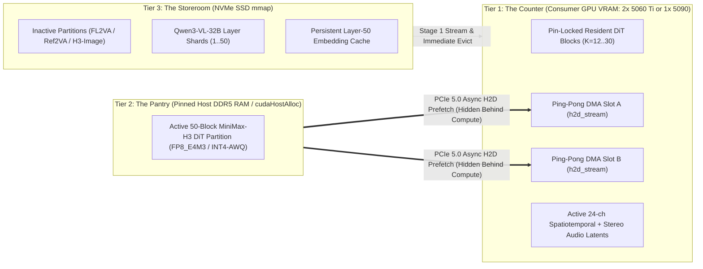

# openfal ⚡

[](LICENSE)
[](https://huggingface.co/MiniMaxAI/MiniMax-H3)
[](#falai-compatible-endpoints)

**`openfal`** is an open-source, MIT-licensed local inference engine and `fal.ai`-compatible API + Studio Web UI designed to run the **33B-parameter open-weights `MiniMax-H3` & `MiniMax-H3-Image` multimodal family** (Text-to-Video with native Stereo Audio, Image-to-Video, Omni-Reference Video, **Video Face Swap / Recast**, and 4K Text/Image-to-Image) on **consumer GPUs** (`2x RTX 5060 Ti` 24GB/32GB or `1x RTX 5090` 32GB) **without `vLLM-Omni`**.

Inspired by [**`Niko1221/Strata`**](https://github.com/Niko1221/Strata)—which runs 125B+ MoE LLMs on consumer VRAM by treating GPU VRAM, Pinned DDR5 RAM, and NVMe SSDs as a tightly orchestrated 3-tier hierarchy—`openfal` brings the same bare-metal **Counter / Pantry / Storeroom** architecture (`Strata-DiT`) to Diffusion Transformers.

---

## Why `openfal`? (The Problem with Naive `vLLM-Omni` Serving)

Official serving recipes for `MiniMaxAI/MiniMax-H3` require `vLLM-Omni` and enterprise H100/A100 nodes because naively keeping all components resident in BF16 takes **>190 GB of VRAM**:
* **Qwen3-VL-32B Text/Multimodal Encoder**: ~64 GB (extracts Layer-50 hidden states)
* **MiniMax-H3 33B Single-Stream DiT** (50 blocks, `hidden_size=5376`, 56 heads, `head_dim=128`): ~66 GB per task partition (`FL2VA`, `Ref2VA`, `H3-Image`)
* **Hybrid CNN-ViT VAE (24-layer 2D ViT decoder) + Stereo Audio VAE**: ~4–8 GB

### How `openfal`'s `Strata-DiT` 3-Tier Engine Fits This into 24GB–32GB Consumer VRAM



1. **Stage 1 — Zero-Idle VRAM Text/Reference Encoding (`StreamedQwen3VLEncoder`)**:
   * Checks the LRU `TextEncoderCache` (RAM + NVMe) first (`0 MB` VRAM on hit).
   * On a miss, streams `Qwen3-VL-32B` layers `1..50` through a tiny rolling buffer (`1.1–3.3 GB` peak VRAM), caches the `5376`-dim Layer-50 sequence, and **immediately evicts `Qwen3-VL` from VRAM** before diffusion begins.
2. **Stage 2 — Double-Buffered 50-Block DiT Streaming & Dual-GPU Pipeline Sharding (`StrataDiTBlockStreamer`)**:
   * Each of the 50 MiniMax-H3 DiT blocks is `~660 MB` in `FP8_E4M3` (native on Blackwell RTX 5060 Ti / 5090) or `~340 MB` in `INT4_AWQ`.
   * **Tier 1 (VRAM Counter)** pins $K$ blocks permanently in VRAM plus **2 Ping-Pong DMA Prefetch Slots (`Slot A`, `Slot B`)** per GPU.
   * **Tier 2 (Pinned Host RAM Pantry)** holds the remaining $50 - K$ blocks in `cudaHostAlloc` page-locked DDR5 memory. While `compute_stream` evaluates Block $i$, `h2d_stream` asynchronously transfers Block $i+1$ over PCIe 5.0 (`~58 GB/s`), hiding transfer latency behind multi-head spatiotemporal self-attention compute.
   * **Dual-GPU Pipeline Sharding (`2x RTX 5060 Ti`)**: GPU 0 owns Blocks `0..24` and GPU 1 owns Blocks `25..49`. The packed latent sequence crosses GPUs only **once per denoising step** via `cudaMemcpyPeerAsync`.
3. **Stage 3 — Tiled Hybrid CNN-ViT VAE + Stereo Audio Muxing (`TiledHybridViTVAE`)**:
   * Decodes 24-channel latents via `512x512` spatial tiles with feathered blending + 44.1kHz stereo audio synthesis, muxed into `.mp4` (H.264 + AAC) via `ffmpeg`.
4. **Instant VRAM Sleep / Wake (`/v1/engine/sleep` & `/v1/engine/wake`)**:
   * Evicts all resident GPU weights back to Pinned Host RAM (`0.0 GB` VRAM usage) with a single API call or UI click—without stopping the server.

---

## Consumer GPU Hardware Profiles

| Profile ID | Target Hardware | Total VRAM | Quantization | VRAM Counter (Resident) | Host RAM Pantry (Streamed) | Strategy |
| :--- | :--- | :---: | :---: | :---: | :---: | :--- |
| `dual_5060ti_32gb` | **2x RTX 5060 Ti (2x 16GB)** | **32 GB** | `fp8_e4m3` | **28 / 50 blocks** (14/GPU) | 22 / 50 blocks | Dual-GPU Pipeline + Async DMA |
| `dual_5060ti_24gb` | **2x Consumer GPU (24GB total)** | **24 GB** | `int4_awq` | **24 / 50 blocks** (12/GPU) | 26 / 50 blocks | Dual-GPU Pipeline + INT4 DMA |
| `single_5090_32gb` | **1x RTX 5090 (32GB GDDR7)** | **32 GB** | `fp8_e4m3` | **30 / 50 blocks** | 20 / 50 blocks | Single-GPU Ring Buffer DMA |
| `single_4090_24gb` | **1x RTX 4090 / 3090 (24GB)** | **24 GB** | `fp8_e4m3` | **20 / 50 blocks** | 30 / 50 blocks | Single-GPU Ring Buffer DMA |
| `single_16gb_lowvram` | **1x RTX 5060 Ti / 4080 (16GB)** | **16 GB** | `int4_awq` | **12 / 50 blocks** | 38 / 50 blocks | Micro-Counter + INT4 DMA |

---

## Supported `fal.ai`-Compatible Endpoints

`openfal` is drop-in compatible with `@fal-ai/client` (JS/TS), `fal_client` / `openfal` (Python), and `curl`:

| Endpoint ID | Partition | Capability |
| :--- | :---: | :--- |
| `minimax/h3/text-to-video` & `minimax/h3-max/text-to-video` | `FL2VA` | Text-to-Video (480P–4K) with native synchronized stereo audio |
| `minimax/h3/image-to-video` & `minimax/h3-max/image-to-video` | `FL2VA` | First-frame & Last-frame conditioned Image-to-Video |
| `minimax/h3-max/recast` | `Ref2VA` | **Video Face Swap / Character Recast** using reference face image(s) + target video |
| `minimax/h3/reference-to-video` & `minimax/h3-max/reference-to-video` | `Ref2VA` | Omni-Reference to Video (up to 9 reference images, 3 videos, 3 audio clips) |
| `minimax/h3-max/relight` & `minimax/h3-max/insert-video` | `Ref2VA` | Video relighting and subject insertion |
| `minimax/h3/text-to-image` | `H3-Image` | Multi-megapixel (up to 4096×4096) Text-to-Image |
| `minimax/h3/image-to-image` | `H3-Image` | Reference-guided Image-to-Image & portrait face swap |

> Both `/minimax/...` and `/fal-ai/minimax/...` routes are supported, along with full queue endpoints (`/queue/...`, `/requests/{id}/status`, `/requests/{id}/status/stream`, `/requests/{id}`).

---

## Quickstart

### 1. Install `openfal`

```bash
git clone https://github.com/esokullu/openfal.git
cd openfal
pip install -e ".[dev]"

# Optional: Build the native C++/CUDA Strata DMA & FP8/INT4 dequantization extension (csrc/)
OPENFAL_BUILD_CUDA=1 pip install -e . --no-build-isolation
```

### 2. Download Open-Source `MiniMax-H3` Weights (Optional for Local Synthesis / Testing)

```bash
openfal download --weights-dir ./weights/MiniMax-H3
# Or directly via Hugging Face CLI:
hf download MiniMaxAI/MiniMax-H3 --local-dir ./weights/MiniMax-H3
hf download MiniMaxAI/MiniMax-H3-Image --local-dir ./weights/MiniMax-H3/H3-Image
```

*(Note: `openfal` includes a built-in deterministic synthesis & `ffmpeg` stereo muxing pipeline so you can test the Studio Web UI, `fal.ai` queue endpoints, and Video Face Swap workflows immediately even before downloading the 66GB checkpoint.)*

### 3. Launch the Server & Studio Web UI

```bash
# Start with the 2x RTX 5060 Ti (32GB) profile:
openfal serve --profile dual_5060ti_32gb --port 8000

# Or for 2x 5060 Ti (24GB total VRAM):
openfal serve --profile dual_5060ti_24gb --port 8000

# Or for 1x RTX 5090 (32GB VRAM):
openfal serve --profile single_5090_32gb --port 8000
```

Open **`http://localhost:8000/`** in your browser to use the interactive **openfal Studio Web UI** with live 50-block VRAM/RAM residency visualization.

---

## API Usage Examples

### JavaScript / TypeScript (`@fal-ai/client`)

```javascript
import { fal } from "@fal-ai/client";

// Point @fal-ai/client to your local openfal server
fal.config({ proxyUrl: "http://localhost:8000" });

const result = await fal.subscribe("minimax/h3-max/recast", {
  input: {
    prompt: "Cinematic close-up shot in studio lighting, natural expressions",
    face_image_url: "https://example.com/my-reference-face.png",
    target_video_url: "https://example.com/input-video.mp4",
    duration: 5,
    resolution: "768P",
  },
  logs: true,
  onQueueUpdate: (update) => {
    if (update.status === "IN_PROGRESS") {
      update.logs.forEach((l) => console.log(l.message));
    }
  },
});

console.log("Generated Video:", result.data.video.url);
```

### Python (`openfal` SDK)

```python
import openfal

# Upload a local reference face image
face_url = openfal.upload_file("./my_face.png", base_url="http://localhost:8000")

# Run Video Face Swap / Recast (Ref2VA partition)
res = openfal.subscribe(
    "minimax/h3-max/recast",
    arguments={
        "prompt": "Cyberpunk detective talking in neon rain, stereo rain audio",
        "face_image_url": face_url,
        "duration": 5.0,
        "resolution": "768P",
    },
    base_url="http://localhost:8000",
)
print("Output MP4:", res["video"]["url"])
```

---

## License

Released under the [MIT License](LICENSE).
