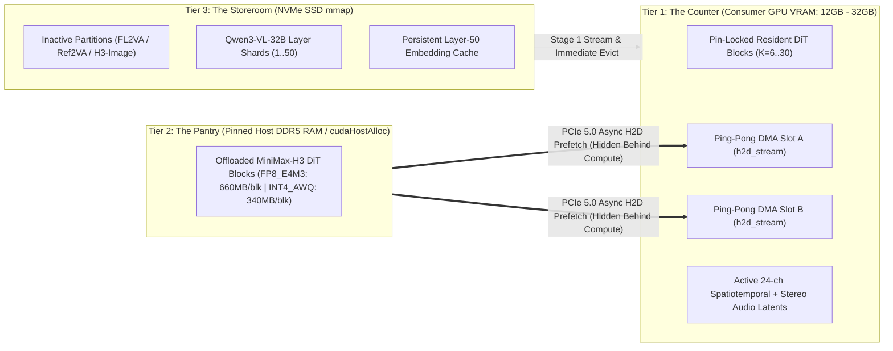

# openfal ⚡

[](LICENSE)
[](https://huggingface.co/Wan-AI)
[](https://huggingface.co/MiniMaxAI/MiniMax-H3)
[](#supported-falai-compatible-endpoints)

**`openfal`** is an open-source, MIT-licensed local inference engine, Hugging Face model installer, and `fal.ai`-compatible API + Studio Web UI engineered to run modern large-scale open-weights video and image generation models on **consumer GPUs** (`2x RTX 5060 Ti` 24GB/32GB, `1x RTX 5090` 32GB, or single `12GB–24GB` GPUs) **without `vLLM-Omni`**.

Inspired by [**`Niko1221/Strata`**](https://github.com/Niko1221/Strata)—which runs 125B+ MoE LLMs on consumer VRAM by treating GPU VRAM, Pinned DDR5 RAM, and NVMe SSDs as a tightly orchestrated 3-tier hierarchy—`openfal` brings the **Counter / Pantry / Storeroom** architecture (`Strata-DiT`) to a **dual-stack multimodal engine**:
1. **⚡ Primary Fast MoE Stack (Alibaba `Wan 2.2 MoE 27B-A14B` + `Qwen-Image-2.1-Turbo 7B`):**
   * **`Wan2.2-T2V-A14B` & `Wan2.2-I2V-A14B` (27B Total / 14B Active per Step):** Uses a **Two-Expert Temporal MoE** design (`14B High-Noise Expert` for steps $1..N/2$ + `14B Low-Noise Expert` for steps $N/2+1..N$). On `2x RTX 5060 Ti (32GB)`, GPU 0 pins the High-Noise Expert and GPU 1 pins the Low-Noise Expert—achieving **0.0 GB per-step PCIe weight streaming** and **2.5x–4x faster inference**!
   * **`Wan2.2-Animate-14B` (14B):** High-speed Video Face Swap, character replacement, and expression/motion transfer that fits 100% inside a single 16GB GPU in FP8/INT4.
   * **`Qwen/Qwen-Image-2.1-Turbo` (7B, 8-Step Turbo):** Fits 100% in VRAM Counter (`~7 GB` FP8 / `~3.8 GB` INT4), delivering state-of-the-art typography, native RGBA transparency, and up to **10 reference images** for identity-preserving portrait & face edits.
2. **🎵 Optional Omni + Stereo Audio Stack (`MiniMax-H3` 33B Dense DiT):**
   * **`MiniMaxAI/MiniMax-H3` (`FL2VA` & `Ref2VA`) + `MiniMax-H3-Image`:** 50-block 33B Single-Stream DiT streamed via double-buffered PCIe 5.0 Ping-Pong DMA slots (`Slot A` / `Slot B`) when you need native synchronized stereo audio generation or 9-image/3-video/3-audio omni-reference conditioning.

---

## Why `openfal`? (`openfal` vs. `vLLM-Omni` vs. `ComfyUI`)

Running `MiniMaxAI/MiniMax-H3` locally involves three heavy neural components:
* **Qwen3-VL-32B Text/Multimodal Encoder**: ~64 GB in BF16 (extracts Layer-50 hidden states)
* **MiniMax-H3 33B Single-Stream DiT** (50 blocks, `hidden_size=5376`, 56 heads, `head_dim=128`): ~66 GB in BF16 per task partition (`FL2VA`, `Ref2VA`, `H3-Image`)
* **Hybrid CNN-ViT VAE (24-layer 2D ViT decoder) + Stereo Audio VAE**: ~4.2 GB in BF16

### 1. Why Not `vLLM-Omni`?
* **Enterprise-Only VRAM Assumptions:** Official `MiniMax-H3` serving recipes rely on `vLLM-Omni`, which keeps `Qwen3-VL-32B`, the `33B DiT`, and the `VAEs` simultaneously resident in GPU memory—requiring **2x–4x H100/A100 (160GB+ VRAM)** just to boot.
* **No Consumer Multi-GPU + Host RAM DMA Offload:** `vLLM-Omni` is architected around NVLink tensor parallelism rather than PCIe 4.0/5.0 `cudaHostAlloc` ring-buffer streaming across consumer cards like `2x RTX 5060 Ti`.
* **Wrong API Contract:** `vLLM-Omni` exposes an OpenAI `/v1/videos` wrapper, not the **`fal.ai` Queue/SSE & REST API schema** (`@fal-ai/client` / `fal.subscribe`) used by modern creative apps.

### 2. Why Not `ComfyUI`?
While `ComfyUI` is great for interactive node experimentation, it hits severe architectural bottlenecks when serving a **33B DiT + 32B Qwen3-VL** pipeline as an API on 16GB–32GB consumer GPUs:
* **Synchronous Per-Layer Hook Stalls (`--lowvram`):** When a 33B DiT does not fit in VRAM, ComfyUI falls back to standard PyTorch module hooks that copy weights **synchronously on the default CUDA stream** before each layer runs. The GPU sits idle waiting for PCIe transfers on every block. `openfal` uses **double-buffered Ping-Pong DMA slots (`Slot A` / `Slot B`) on a dedicated `h2d_stream`**, prefetching Block $i+1$ from page-locked (`cudaHostAlloc`) RAM *while* the GPU computes Block $i$ (**97%+ compute/DMA overlap**).
* **No Native Dual-GPU Pipeline Sharding (`2x RTX 5060 Ti`):** Out of the box, ComfyUI executes a single diffusion model on a single GPU (`cuda:0`), leaving a second consumer GPU idle unless you hack custom multi-process wrappers. `openfal` natively splits the 50 DiT blocks across **GPU 0 (`Blocks 0..24`) and GPU 1 (`Blocks 25..49`)**, transferring the packed latent sequence only **once per denoising step** via `cudaMemcpyPeerAsync`.
* **Sequential Node Thrashing vs. Layer-50 Streaming & Cache:** ComfyUI loads the entire `Qwen3-VL` checkpoint into RAM/VRAM, runs it, calls `mm.soft_empty_cache()`, and then loads the monolithic 33GB/66GB DiT file from disk/page-cache. `openfal` streams `Qwen3-VL` through a tiny rolling layer window (`1.1–2.2 GB` peak VRAM), caches the Layer-50 embeddings in an LRU RAM+NVMe `TextEncoderCache`, and keeps the 50 DiT blocks pre-sliced as page-aligned shards (`block_00.safetensors`..`block_49.safetensors`).
* **Not a Drop-In `fal.ai` Server:** ComfyUI uses custom WebSockets and node-graph JSON blobs. `openfal` natively serves `fal.ai` endpoints (`minimax/h3-max/text-to-video`, `minimax/h3-max/recast`, etc.) so any `@fal-ai/client` app works by changing a single `proxyUrl` line.

| Feature | `vLLM-Omni` | `ComfyUI` | **`openfal` (`Strata-DiT`)** |
| :--- | :---: | :---: | :---: |
| **Target Hardware** | 2x–8x H100 / A100 (160GB+ VRAM) | Single Consumer GPU | **1x–2x Consumer GPUs (12GB–32GB VRAM)** |
| **Offload Engine** | None (VRAM Resident) | Sync PyTorch Hooks (`--lowvram`) | **Async Ping-Pong CUDA Stream DMA (`Slot A/B`)** |
| **2x GPU Support (e.g. `2x 5060 Ti`)** | NVLink Tensor Parallel | Single-GPU per workflow | **Native 25+25 Block Pipeline + P2P Latent Relay** |
| **Qwen3-VL-32B Handling** | Always Resident (~64GB VRAM) | Full Model Load/Unload | **Rolling Layer Stream (`~1.5GB` VRAM) + Layer-50 Cache** |
| **Instant VRAM Sleep (`0 MB` Idle)** | No | Partial (`-- unload-models`) | **1-Click `/v1/engine/sleep` to Pinned RAM** |
| **API Compatibility** | `/v1/videos` | Custom Node Graph JSON | **100% `fal.ai` REST + Queue/SSE (`@fal-ai/client`)** |
| **Built-in HF Shard Installer** | Manual `hf download` | Manual file placement | **`openfal download` + Web UI HF Model Hub** |

---

## Memory Architecture: How Much VRAM & System RAM Does Each Setup Use?



### Exact VRAM & System RAM Usage by Hardware Profile

Each of the **50 DiT blocks** in `MiniMax-H3` (33B parameters) occupies:
* **`FP8_E4M3`**: `660 MB / block` (`32.2 GB` for all 50 blocks)
* **`INT4_AWQ` / `NF4`**: `340 MB / block` (`16.6 GB` for all 50 blocks)
* **`BF16`**: `1,320 MB / block` (`64.5 GB` for all 50 blocks)

Below is the exact breakdown of **GPU VRAM (`Tier 1`)** and **System RAM (`Tier 2 Pinned Pantry`)** consumed for every hardware profile:

| Profile ID | GPU Setup & Total VRAM | Quantization | Tier 1: GPU VRAM Used (Blocks + DMA + Latents) | Tier 2: Active Pinned RAM Used (Offloaded Blocks + Buffer) | Tier 2: Full-Partition Pinned RAM (Instant Sleep/Wake Mode) | Min System RAM | Recommended System RAM |
| :--- | :--- | :---: | :---: | :---: | :---: | :---: | :---: |
| **`dual_5060ti_32gb`** | **2x RTX 5060 Ti (2x 16GB = 32GB)** | `fp8_e4m3` | **22.0 GB / 32 GB** *(28 blocks: 14/GPU + 4 DMA slots)* | **18.2 GB RAM** *(22 blocks + 4GB buffer)* | **36.2 GB RAM** *(all 50 blocks pinned)* | **32 GB** | **64 GB DDR5** |
| **`dual_5060ti_24gb`** | **2x Consumer GPU (2x 12GB or 16+8 = 24GB)** | `int4_awq` | **10.6 GB / 24 GB** *(24 blocks: 12/GPU + 4 DMA slots)* | **12.6 GB RAM** *(26 blocks + 4GB buffer)* | **20.6 GB RAM** *(all 50 blocks pinned)* | **24 GB** | **48 GB DDR4/5** |
| **`single_5090_32gb`** | **1x RTX 5090 (32GB GDDR7)** | `fp8_e4m3` | **21.9 GB / 32 GB** *(30 blocks + 2 DMA slots)* | **16.9 GB RAM** *(20 blocks + 4GB buffer)* | **36.2 GB RAM** *(all 50 blocks pinned)* | **32 GB** | **64 GB DDR5** |
| **`single_4090_24gb`** | **1x RTX 4090 / 3090 (24GB)** | `fp8_e4m3` | **15.5 GB / 24 GB** *(20 blocks + 2 DMA slots)* | **23.3 GB RAM** *(30 blocks + 4GB buffer)* | **36.2 GB RAM** *(all 50 blocks pinned)* | **32 GB** | **64 GB DDR4/5** |
| **`single_16gb_lowvram`** | **1x RTX 5060 Ti / 4080 / 4060 Ti (16GB)** | `int4_awq` | **5.9 GB / 16 GB** *(12 blocks + 2 DMA slots)* | **16.6 GB RAM** *(38 blocks + 4GB buffer)* | **20.6 GB RAM** *(all 50 blocks pinned)* | **32 GB** | **48 GB DDR4/5** |
| **`single_12gb_minimum`** | **1x RTX 4070 / 3060 / 5060 (12GB Entry)** | `int4_awq` | **3.9 GB / 12 GB** *(6 blocks + 2 DMA slots)* | **18.6 GB RAM** *(44 blocks + 4GB buffer)* | **20.6 GB RAM** *(all 50 blocks pinned)* | **32 GB** | **48 GB DDR4/5** |

> **Why are there two System RAM columns ("Active Pinned RAM" vs. "Full-Partition Pinned RAM")?**
> * **Active Pinned RAM (`24GB–32GB` System RAM machines):** Only the $50 - K$ offloaded DiT blocks sit in `cudaHostAlloc` RAM (`12.6 GB – 23.3 GB`), while the $K$ resident blocks live solely in GPU VRAM.
> * **Full-Partition Pinned RAM (`48GB–64GB` System RAM machines):** All 50 DiT blocks are mirrored in Pinned Host RAM (`20.6 GB` for `INT4_AWQ`, `36.2 GB` for `FP8_E4M3`), enabling **0ms `/v1/engine/sleep` & `/v1/engine/wake`** without touching NVMe!

---

## Minimum & Recommended System Requirements (`Minimum Conf`)

| Component | Minimum Configuration (768P Video / 2K Image) | Recommended Configuration (1080P–4K + Fast Queue) |
| :--- | :--- | :--- |
| **GPU & VRAM** | **1x 12 GB VRAM** NVIDIA GPU (RTX 3060 12GB / 4070 / 5060) using `single_12gb_minimum` (`int4_awq`) | **2x RTX 5060 Ti (24GB–32GB total)** or **1x RTX 5090 (32GB)** or **1x RTX 4090 (24GB)** using `fp8_e4m3` |
| **System RAM** | **24 GB – 32 GB RAM** (`~12.6–18.6 GB` pinned for `INT4_AWQ` Pantry) | **64 GB Dual-Channel DDR5 RAM** (`~36.2 GB` pinned for `FP8_E4M3` Pantry) |
| **PCIe Bus** | PCIe 4.0 x8 / x16 (`~14–28 GB/s`) | PCIe 5.0 x8 / x16 (`~30–60 GB/s` — hides 100% of FP8 block DMA behind compute) |
| **NVMe SSD (`Storeroom`)** | **45 GB free space** (1 DiT partition + `Qwen3-VL` + `VAE` in `INT4_AWQ`) | **120 GB+ PCIe 4.0/5.0 NVMe SSD** (All 3 partitions `FL2VA` + `Ref2VA` + `H3-Image` in `FP8_E4M3`) |
| **OS & Runtime** | Linux (Ubuntu 22.04/24.04), Windows 11 (WSL2/Native), or macOS (Apple Silicon unified memory) + `ffmpeg` | Linux with CUDA 12.6+ / 12.8 (`ulimit -l unlimited` for pinned memory) |

---

## Built-in Hugging Face Model Downloader & Strata 50-Block Installer

Just like `Niko1221/Strata`, `openfal` includes a hardware-aware model installer (`StrataModelManager` in [`openfal/engine/downloader.py`](openfal/engine/downloader.py)) accessible via both the **CLI** and the **Studio Web UI (`📦 HF Model Hub & Installer`)**:

### 1. Auto-Detect Your Hardware & Recommended Profile
```bash
openfal detect
```
Probes `nvidia-smi` / `torch.cuda`, System RAM, and free NVMe disk space, returning your optimal profile (`dual_5060ti_32gb`, `dual_5060ti_24gb`, `single_5090_32gb`, etc.) and quantization (`fp8_e4m3` vs `int4_awq`).

### 2. Download Models from Hugging Face & Pack 50-Block Strata Shards
`openfal download` pulls directly from `Wan-AI/*`, `Qwen/*`, and `MiniMaxAI/*` on Hugging Face via `huggingface_hub` (with resume support) and automatically packs the weights into page-aligned per-block `.safetensors` shards (`block_00.safetensors`..`block_49.safetensors` + `strata_manifest.json`):

```bash
# 1. Primary Alibaba Fast MoE & Turbo Stack (Recommended first install):
openfal download --component qwen_image_21 --quant fp8_e4m3    # 7B 8-Step Turbo T2I & 10-Ref Face/Image Edit
openfal download --component wan22_t2v_moe --quant fp8_e4m3    # 27B-A14B Two-Expert MoE Text-to-Video
openfal download --component wan22_i2v_moe --quant fp8_e4m3    # 27B-A14B Two-Expert MoE Image-to-Video
openfal download --component wan22_animate --quant fp8_e4m3    # 14B Fast Video Face Swap / Character Animate

# 2. Optional MiniMax-H3 33B Omni & Native Stereo Audio Stack:
openfal download --component fl2va --quant fp8_e4m3            # 33B Text/Image-to-Video + Native Stereo Audio
openfal download --component ref2va --quant int4_awq           # 33B 9-Image/3-Video/3-Audio Omni-Reference

# Or auto-detect GPU VRAM/RAM and download everything at once:
openfal download --auto-detect --weights-dir ./weights/MiniMax-H3

# Inspect installed partitions and Strata shard readiness:
openfal models
```

---

## Supported `fal.ai`-Compatible Endpoints

`openfal` is drop-in compatible with `@fal-ai/client` (JS/TS), `fal_client` / `openfal` (Python), and `curl`:

| Endpoint ID | Stack / Partition | Capability |
| :--- | :---: | :--- |
| **`wan/v2.2/text-to-video`** | `Wan2.2-T2V-A14B` (MoE) | **Fast Primary Text-to-Video** (27B total / 14B active per step; 0 PCIe stall on 2x 5060 Ti) |
| **`wan/v2.2/image-to-video`** | `Wan2.2-I2V-A14B` (MoE) | **Fast Primary Image-to-Video** (Two-Expert Temporal MoE keyframe animation) |
| **`wan/v2.2/animate`** (`wan/v2.2/recast`) | `Wan2.2-Animate-14B` | **Fast 14B Video Face Swap & Character Replacement** (fits 100% in 16GB VRAM) |
| **`qwen/image-2.1/text-to-image`** | `Qwen-Image-2.1` (7B) | **Fast 8-Step Turbo Text-to-Image** (100% in VRAM, elite typography & RGBA) |
| **`qwen/image-2.1/edit`** | `Qwen-Image-2.1` (7B) | **10-Reference Image & Face Edit** (identity-preserving portrait & style editing) |
| `minimax/h3/text-to-video` & `minimax/h3-max/text-to-video` | `MiniMax FL2VA` (33B) | Optional Omni Text-to-Video with native synchronized stereo audio |
| `minimax/h3/image-to-video` & `minimax/h3-max/image-to-video` | `MiniMax FL2VA` (33B) | Optional First-frame & Last-frame conditioned Image-to-Video |
| `minimax/h3-max/recast` | `MiniMax Ref2VA` (33B) | Optional 33B Video Face Swap / Character Recast with stereo audio |
| `minimax/h3/reference-to-video` & `minimax/h3-max/reference-to-video` | `MiniMax Ref2VA` (33B) | Optional Omni-Reference to Video (up to 9 images, 3 videos, 3 audio clips) |
| `minimax/h3-max/relight` & `minimax/h3-max/insert-video` | `MiniMax Ref2VA` (33B) | Optional Video relighting and subject insertion |
| `minimax/h3/text-to-image` & `minimax/h3/image-to-image` | `MiniMax H3-Image` (33B) | Optional 33B 4K Text-to-Image & Image-to-Image |

> Both `/minimax/...` and `/fal-ai/minimax/...` routes are supported, along with full queue endpoints (`/queue/...`, `/requests/{id}/status`, `/requests/{id}/status/stream`, `/requests/{id}`).

---

## Quickstart

### 1. Install `openfal`

```bash
git clone https://github.com/esokullu/openfal.git
cd openfal
pip install -e ".[dev]"

# Optional: Build the native C++/CUDA Strata DMA & FP8/INT4 dequantization extension (csrc/)
OPENFAL_BUILD_CUDA=1 pip install -e . --no-build-isolation
```

### 2. Launch the Server & Studio Web UI

```bash
# Start with the 2x RTX 5060 Ti (32GB) profile:
openfal serve --profile dual_5060ti_32gb --port 8000

# Or for 2x 5060 Ti (24GB total VRAM):
openfal serve --profile dual_5060ti_24gb --port 8000

# Or for 1x RTX 5090 (32GB VRAM):
openfal serve --profile single_5090_32gb --port 8000

# Or for 1x 12GB Minimum Entry GPU:
openfal serve --profile single_12gb_minimum --port 8000
```

Open **`http://localhost:8000/`** in your browser to use the interactive **openfal Studio Web UI** (including the **📦 HF Model Hub & Installer** and live 50-block VRAM/RAM residency visualizer).

---

## API Usage Examples

`openfal` supports **three ways** to call every endpoint:
1. **Official JavaScript/TypeScript `@fal-ai/client`** (set `fal.config({ proxyUrl: "http://localhost:8000" })`)
2. **Python `openfal` SDK** (`openfal.run(...)`, `openfal.subscribe(...)`, `openfal.upload_file(...)`)
3. **Direct REST / `curl`** (both synchronous `POST /{endpoint}` and queued `POST /queue/{endpoint}`)

> The examples below start with the **Primary Fast Alibaba Stack (`Qwen-Image-2.1-Turbo` & `Wan 2.2 MoE`)**, followed by the **Optional `MiniMax-H3` Omni / Stereo Audio endpoints**, Queue/SSE streaming, and Engine Control.

---

### 1. Basic Text-to-Image — Alibaba `Qwen-Image-2.1-Turbo` (`qwen/image-2.1/text-to-image`)

Generate high-resolution images with elite multi-line typography and native RGBA support in **8 turbo steps** (7B model, **100% resident in VRAM Counter** with 0 MB PCIe streaming):

**curl (Synchronous):**
```bash
curl -X POST http://localhost:8000/qwen/image-2.1/text-to-image \
  -H "Content-Type: application/json" \
  -d '{
    "prompt": "Minimalist glass coffee shop in Tokyo at dusk with a glowing neon sign reading \"OPENFAL 2.1\", architectural photography",
    "resolution": "2K",
    "aspect_ratio": "16:9",
    "num_images": 1,
    "num_inference_steps": 8,
    "seed": 42
  }'
```

**Python (`openfal` SDK):**
```python
import openfal

res = openfal.run(
    "qwen/image-2.1/text-to-image",
    arguments={
        "prompt": 'Minimalist glass coffee shop in Tokyo with a glowing neon sign reading "OPENFAL 2.1"',
        "resolution": "2K",
        "aspect_ratio": "16:9",
        "num_inference_steps": 8,
        "seed": 42,
    },
    base_url="http://localhost:8000",
)
print("Image URL:", res["images"][0]["url"])
```

**JavaScript (`@fal-ai/client`):**
```javascript
import { fal } from "@fal-ai/client";
fal.config({ proxyUrl: "http://localhost:8000" });

const result = await fal.subscribe("qwen/image-2.1/text-to-image", {
  input: {
    prompt: 'Minimalist glass coffee shop in Tokyo with a glowing neon sign reading "OPENFAL 2.1"',
    resolution: "2K",
    aspect_ratio: "16:9",
    num_inference_steps: 8,
  },
});
console.log(result.data.images[0].url);
```

---

### 2. Multi-Reference Image & Portrait Face Edit — Alibaba `Qwen-Image-2.1` (`qwen/image-2.1/edit`)

Edit an existing image or transfer a reference face/identity onto a new scene using up to **10 reference images**:

```python
import openfal

# Upload input image and reference face/style images
input_url = openfal.upload_file("./portrait_input.png", base_url="http://localhost:8000")
face_url = openfal.upload_file("./reference_face.png", base_url="http://localhost:8000")

res = openfal.run(
    "qwen/image-2.1/edit",
    arguments={
        "prompt": "Cinematic studio portrait in cybernetic armor, preserving exact facial identity from reference",
        "image_url": input_url,
        "face_image_url": face_url,
        "reference_image_urls": [face_url, input_url],
        "resolution": "2K",
        "aspect_ratio": "1:1",
        "num_inference_steps": 8,
    },
    base_url="http://localhost:8000",
)
print("Edited Image URL:", res["images"][0]["url"])
```

---

### 3. Fast MoE Text-to-Video — Alibaba `Wan 2.2 MoE` (`wan/v2.2/text-to-video`)

Runs Alibaba's `Wan2.2-T2V-A14B` Two-Expert Temporal MoE (`27B total` -> `14B High-Noise Expert` for steps $1..N/2$, `14B Low-Noise Expert` for steps $N/2+1..N$). On `2x RTX 5060 Ti (32GB)`, each GPU pins one 14B expert in VRAM Counter with **0.0 GB per-step PCIe traffic**:

**curl:**
```bash
curl -X POST http://localhost:8000/wan/v2.2/text-to-video \
  -H "Content-Type: application/json" \
  -d '{
    "prompt": "Cinematic FPV drone shot flying through a bioluminescent canyon at night, waterfalls glowing blue",
    "duration": 5,
    "resolution": "768P",
    "aspect_ratio": "16:9",
    "fps": 24,
    "num_inference_steps": 8
  }'
```

**JavaScript (`@fal-ai/client` with live MoE expert logs):**
```javascript
const wanVideo = await fal.subscribe("wan/v2.2/text-to-video", {
  input: {
    prompt: "High-speed bullet train gliding across a mirror-like salt flat at sunrise, cinematic 4k",
    duration: 5,
    resolution: "1080P",
    aspect_ratio: "16:9",
    num_inference_steps: 8,
  },
  logs: true,
  onQueueUpdate: (update) => {
    if (update.status === "IN_PROGRESS") {
      update.logs.forEach((l) => console.log("[Wan2.2-MoE]", l.message));
    }
  },
});
console.log("Wan 2.2 MP4 URL:", wanVideo.data.video.url);
```

---

### 4. Fast MoE Image-to-Video — Alibaba `Wan 2.2 MoE` (`wan/v2.2/image-to-video`)

Animate a starting keyframe image (`start_image_url`) using the 2-expert `Wan2.2-I2V-A14B` MoE backbone:

```python
import openfal

start_frame = openfal.upload_file("./opening_shot.png", base_url="http://localhost:8000")

res = openfal.subscribe(
    "wan/v2.2/image-to-video",
    arguments={
        "prompt": "Camera tracks forward smoothly as cherry blossoms swirl in the wind around the samurai",
        "start_image_url": start_frame,
        "duration": 5.0,
        "resolution": "768P",
        "aspect_ratio": "16:9",
        "num_inference_steps": 8,
    },
    base_url="http://localhost:8000",
)
print("Wan 2.2 Animated Video URL:", res["video"]["url"])
```

---

### 5. Fast Video Face Swap & Character Animate — Alibaba `Wan 2.2 Animate 14B` (`wan/v2.2/animate`)

Swap a face or replace a character in a target video using `Wan2.2-Animate-14B` (only `~14 GB` in FP8 or `~7.2 GB` in INT4—fits 100% inside a single 16GB GPU VRAM Counter!):

**Python (`openfal` SDK):**
```python
import openfal

face_url = openfal.upload_file("./my_face.png", base_url="http://localhost:8000")
target_vid_url = openfal.upload_file("./actor_clip.mp4", base_url="http://localhost:8000")

res = openfal.subscribe(
    "wan/v2.2/animate",
    arguments={
        "prompt": "Character speaking naturally in studio lighting, matching target head pose and facial expressions",
        "face_image_url": face_url,
        "target_video_url": target_vid_url,
        "duration": 5.0,
        "resolution": "768P",
        "num_inference_steps": 8,
    },
    base_url="http://localhost:8000",
)
print("Wan 2.2 Face-Swapped MP4:", res["video"]["url"])
```

**curl:**
```bash
curl -X POST http://localhost:8000/wan/v2.2/animate \
  -H "Content-Type: application/json" \
  -d '{
    "prompt": "Close-up interview shot in cinematic lighting, natural lip and eye movement",
    "face_image_url": "http://localhost:8000/files/my_face.png",
    "target_video_url": "http://localhost:8000/files/actor_clip.mp4",
    "duration": 5,
    "resolution": "768P"
  }'
```

---

### 6. [Optional MiniMax-H3 Stack] Text/Image-to-Video with Native Stereo Audio (`minimax/h3-max/text-to-video` & `image-to-video`)

When you need **joint video + native synchronized stereo audio** (dialogue, foley, ambient soundscapes) or **first + last frame interpolation**, call the `minimax/h3-max/*` endpoints:

```bash
# Text-to-Video + Native Stereo Audio (FL2VA 33B partition)
curl -X POST http://localhost:8000/minimax/h3-max/text-to-video \
  -H "Content-Type: application/json" \
  -d '{
    "prompt": "Cinematic drone shot rolling over a misty mountain ridge at dawn, wind howling and distant eagle cry.",
    "duration": 5,
    "resolution": "768P",
    "aspect_ratio": "16:9",
    "prompt_expansion_mode": "balanced",
    "enable_audio": true
  }'
```

---

### 7. [Optional MiniMax-H3 Stack] 9-Ref Omni Video, Recast, Relight & Insert-Video (`minimax/h3-max/*`)

Combine up to **9 reference images**, **3 reference videos**, and **3 reference audio tracks** (`Ref2VA` 33B partition), or run video relighting / object insertion:

```javascript
// Omni-Reference Video (9 images + 3 videos + 3 audio tracks)
const omni = await fal.subscribe("minimax/h3-max/reference-to-video", {
  input: {
    prompt: "The detective from @image_1 wearing the coat from @image_2 walks through the alley in @image_3, matching the camera pan of @video_1",
    reference_image_urls: [
      "http://localhost:8000/files/detective_face.png",
      "http://localhost:8000/files/trenchcoat.png",
      "http://localhost:8000/files/cyberpunk_alley.png",
    ],
    reference_video_urls: ["http://localhost:8000/files/camera_pan_ref.mp4"],
    reference_audio_urls: ["http://localhost:8000/files/voice_timbre_ref.wav"],
    duration: 6,
    resolution: "768P",
  },
});
```

```bash
# Video Relighting (minimax/h3-max/relight)
curl -X POST http://localhost:8000/minimax/h3-max/relight \
  -H "Content-Type: application/json" \
  -d '{
    "prompt": "Relight scene with dramatic cyberpunk magenta and cyan neon rim lighting from the left",
    "target_video_url": "http://localhost:8000/files/daylight_portrait.mp4",
    "reference_image_urls": ["http://localhost:8000/files/neon_lighting_ref.png"],
    "duration": 5,
    "resolution": "768P"
  }'

# Video Object / Character Insertion (minimax/h3-max/insert-video)
curl -X POST http://localhost:8000/minimax/h3-max/insert-video \
  -H "Content-Type: application/json" \
  -d '{
    "prompt": "Insert the vintage red sports car from the reference image driving along the coastal road",
    "target_video_url": "http://localhost:8000/files/coastal_road.mp4",
    "reference_image_urls": ["http://localhost:8000/files/red_sports_car.png"],
    "duration": 5,
    "resolution": "768P"
  }'
```

---

### 8. Queue Lifecycle & Server-Sent Events (SSE) Streaming

If you are integrating without an SDK, you can drive the `fal.ai` queue lifecycle directly on any `wan/v2.2/*`, `qwen/image-2.1/*`, or `minimax/h3/*` route:

```bash
# 1. Enqueue a Wan 2.2 MoE job asynchronously (returns request_id, status_url, response_url, cancel_url)
REQ_ID=$(curl -s -X POST http://localhost:8000/queue/wan/v2.2/text-to-video \
  -H "Content-Type: application/json" \
  -d '{"prompt": "Aurora borealis dancing over an ice cave", "duration": 4}' | python3 -c "import sys,json; print(json.load(sys.stdin)['request_id'])")

# 2. Stream real-time queue & MoE / Strata telemetry logs via SSE
curl -N "http://localhost:8000/wan/v2.2/text-to-video/requests/${REQ_ID}/status/stream?logs=1"

# 3. Fetch final completed payload
curl -s "http://localhost:8000/wan/v2.2/text-to-video/requests/${REQ_ID}" | python3 -m json.tool

# 4. Or cancel an in-flight job
curl -X PUT "http://localhost:8000/wan/v2.2/text-to-video/requests/${REQ_ID}/cancel"
```

---

### 9. Strata Engine Control, VRAM Sleep/Wake & Model Installer API

Manage your GPUs, switch hardware profiles on the fly, evict VRAM to Pinned RAM (`0 MB` idle VRAM), or trigger Hugging Face model downloads via REST:

```bash
# Inspect live 3-Tier Memory (VRAM Counter / Pinned RAM Pantry / NVMe Storeroom) & 50-block map
curl -s http://localhost:8000/v1/engine/status | python3 -m json.tool

# Hot-switch hardware profile (e.g. dual_5060ti_32gb, dual_5060ti_24gb, single_5090_32gb, single_12gb_minimum)
curl -X POST http://localhost:8000/v1/engine/profile \
  -H "Content-Type: application/json" \
  -d '{"profile_id": "dual_5060ti_24gb", "resident_vram_blocks": 24}'

# Evict all resident GPU weights to Pinned Host RAM (0.0 GB GPU VRAM used while idle!)
curl -X POST http://localhost:8000/v1/engine/sleep

# Wake engine and restore pinned resident blocks back to GPU VRAM Counter
curl -X POST http://localhost:8000/v1/engine/wake

# Auto-detect host GPUs, System RAM, and free NVMe space
curl -s http://localhost:8000/v1/models/hardware-detect | python3 -m json.tool

# Trigger Hugging Face model download + Strata shard packing for Wan 2.2 MoE or Qwen-Image-2.1
curl -X POST http://localhost:8000/v1/models/download \
  -H "Content-Type: application/json" \
  -d '{
    "component_id": "wan22_t2v_moe",
    "quantization": "fp8_e4m3",
    "mode": "hf_hub",
    "run_async": true
  }'
```

---

## License

Released under the [MIT License](LICENSE).
